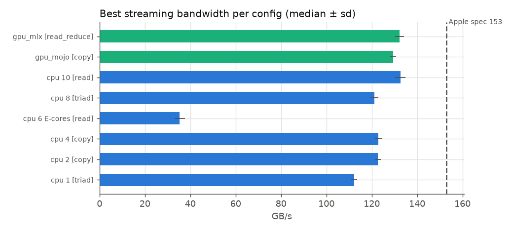
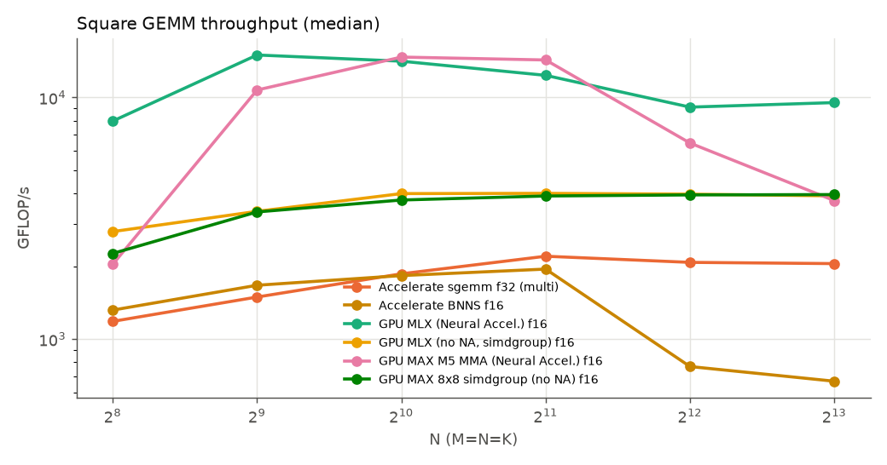
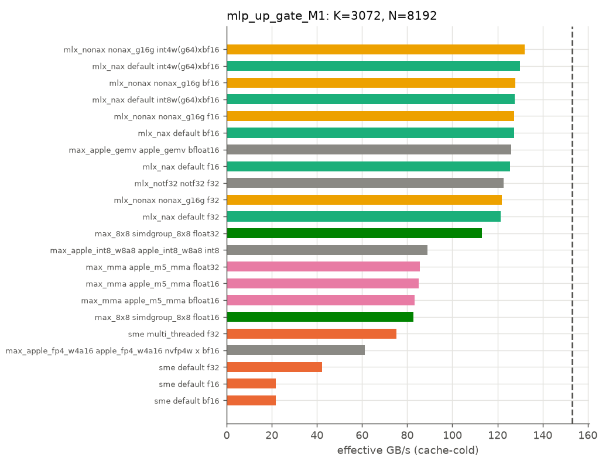
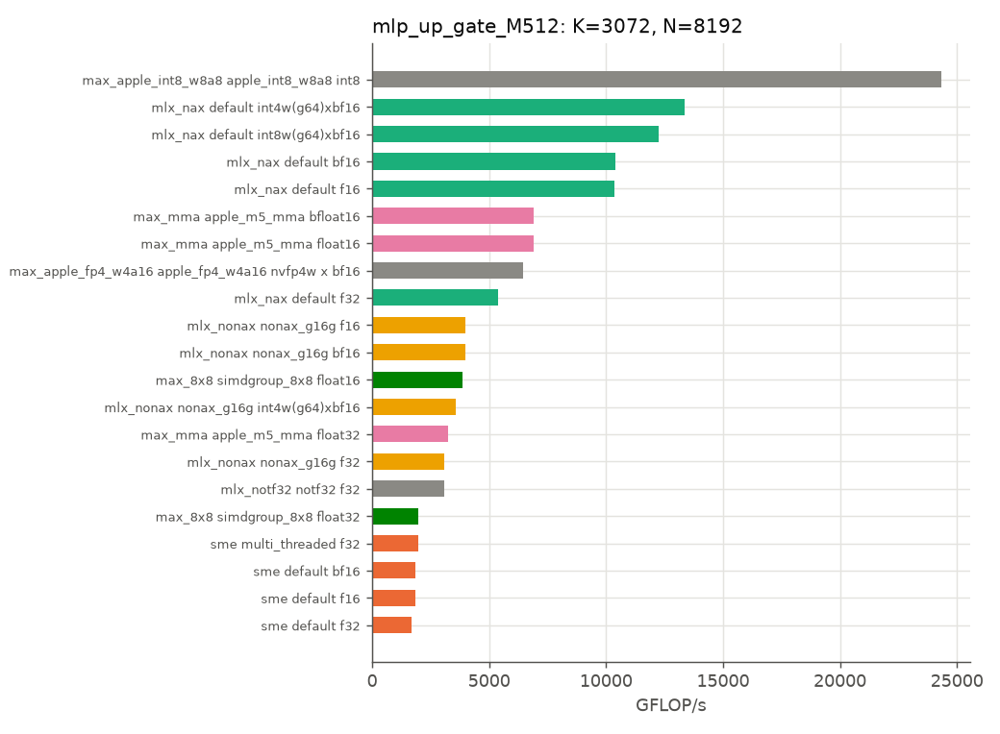
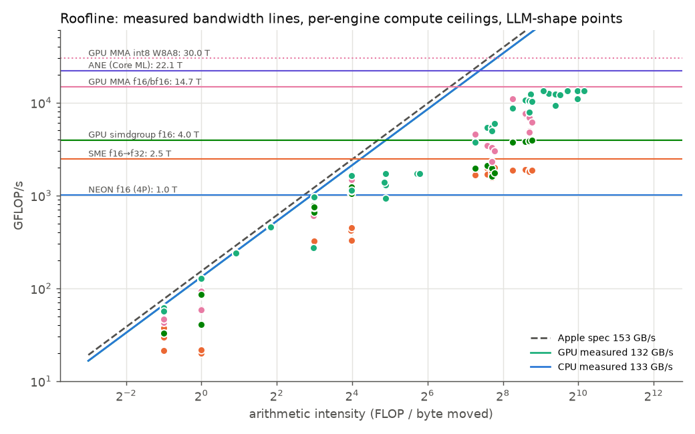

# M5 processor atlas

Bandwidth and matmul throughput for each compute engine, dtype and shape on this Apple M5 (32 GB) MacBook. Generated by `scripts/report.py` from `results/*.json`; do not edit by hand.

Sources and provenance:

- `ane_coreml.json`: idle run
- `cpu_accelerate.json`: idle run
- `cpu_bandwidth.json`: idle run
- `cpu_peak.json`: idle run
- `ggml_mulmat.json`: idle run
- `gpu_max.json`: idle run
- `gpu_mlx_default.json`: idle run
- `gpu_mlx_nonax_g16g.json`: idle run
- `gpu_mlx_notf32.json`: idle run

Every number is the **median ± stddev over ≥5 timed reps** after warmup. Min, max and rep count are in the JSON. Throughput is in GFLOP/s (int: GOP/s; 1 MAC = 2 ops). Memory-bound shapes are timed **cache-cold**: the benchmark cycles through enough weight copies to exceed 256 MiB.

## 1. Machine

| item | value |
|---|---|
| chip | Apple M5 (J704) |
| memory | 32 GiB unified, Apple spec **153 GB/s** ([Apple newsroom](https://www.apple.com/newsroom/2025/10/apple-unleashes-m5-the-next-big-leap-in-ai-performance-for-apple-silicon/)) |
| CPU | 4 P-cores (L1d 128 KiB, shared L2 16 MiB) + 6 E-cores (L1d 64 KiB, L2 6 MiB); 128 B lines, 16 KiB pages |
| CPU ISA | SME 1, SME2 1, SME2p1, SME_F16F16, SME_B16B16, SME_I8I32, BF16, I8MM, DotProd, FP16 (all 1); SVL = 512 bits |
| GPU | "gpu-core-count" = 10 cores, `applegpu_g17g`, Metal 4; Apple: a Neural Accelerator in each GPU core |
| ANE | 16-core Neural Engine (Apple publishes no TOPS figure for M5) |
| software | macOS 26.5; Apple clang version 21.0.0 (clang-2100.1.1.101); Mojo 1.3.0.dev2026110805 (11efb73e); MAX 26.8.0.dev2026110805; MLX 0.32.4; coremltools 9.0; llama.cpp a691b23; no Xcode / Metal toolchain |

## 2. Memory bandwidth

| engine | threads / kernel | read | copy | triad | write |
|---|---|---:|---:|---:|---:|
| cpu | 1 user_interactive(P-pref) | 72 ±2 | 104 ±1 | 112 ±1 | 86 ±1 |
| cpu | 2 user_interactive(P-pref) | 83 ±1 | 123 ±1 | 117 ±1 | 85 ±1 |
| cpu | 4 user_interactive(P-pref) | 83 ±4 | 123 ±2 | 117 ±1 | 88 ±0 |
| cpu | 6 background(E-cores) | 35 ±2 | 28 ±2 | 27 ±1 | 23 ±1 |
| cpu | 8 user_interactive(P-pref) | 102 ±9 | 117 ±2 | 121 ±2 | 81 ±4 |
| cpu | 10 user_interactive(P-pref) | 133 ±2 | 122 ±2 | 123 ±2 | 105 ±1 |
| gpu_mojo | all GPU cores | 125 ±0 | 129 ±1 | 126 ±0 | n/a |
| gpu_mlx | all GPU cores | 132 ±2 | 130 ±2 | 128 ±0 | n/a |

Best median: CPU **133 GB/s** (87% of the 153 GB/s spec), GPU **132 GB/s** (86%). Bytes are the traffic the program sees (copy = 2×, triad = 3×), and write-allocate is not counted. Phase-1 16-bit decode reached about 99 GB/s effective (15.3 tok/s × 6.4 GB).

## 3. CPU compute ceilings (register-only microkernels)

| unit | instr | dtype | 1 thread | 2 | 4 P | 6 E | 10 |
|---|---|---|---:|---:|---:|---:|---:|
| cpu_neon | fmla | f32 | 128 ±2 | 250 ±5 | 471 ±5 | 135 ±19 | 802 ±30 |
| cpu_neon | fmla | f16 | 281 ±7 | 531 ±13 | 1,012 ±28 | 270 ±22 | 1,681 ±66 |
| cpu_neon | fmlal | f16->f32 | 128 ±1 | 244 ±2 | 473 ±1 | 137 ±14 | 792 ±34 |
| cpu_neon | bfdot | bf16->f32 | 73 ±0 | 142 ±1 | 271 ±3 | 73 ±3 | 449 ±15 |
| cpu_neon | bfmmla | bf16->f32 | 72 ±0 | 137 ±0 | 271 ±1 | 70 ±3 | 456 ±13 |
| cpu_neon | sdot | i8->i32 | 490 ±3 | 941 ±4 | 1,871 ±3 | 548 ±45 | 3,165 ±86 |
| cpu_neon | smmla | i8->i32 | 492 ±2 | 939 ±2 | 1,863 ±21 | 552 ±275 | 3,228 ±141 |
| cpu_sme | fmopa | f32 | 2,166 ±8 | 2,137 ±2 | 2,137 ±3 | 127 ±13 | 2,466 ±52 |
| cpu_sme | fmopa | f16->f32 | 2,163 ±10 | 2,137 ±1 | 2,138 ±2 | 129 ±6 | 2,473 ±16 |
| cpu_sme | bfmopa | bf16->f32 | 2,167 ±5 | 2,136 ±1 | 2,137 ±2 | 134 ±12 | 2,476 ±5 |
| cpu_sme | fmopa | f16 | 4,331 ±11 | 4,272 ±2 | 4,275 ±4 | 258 ±11 | 4,946 ±22 |
| cpu_sme | smopa | i8->i32 | 4,328 ±8 | 4,271 ±2 | 4,273 ±3 | 261 ±16 | 4,952 ±14 |

On this run the P-cluster SME unit is **shared**: one thread already reaches the cluster's SME throughput, and more P threads add nothing. The E-cluster has its own small unit. Widening f16→f32 and bf16→f32 FMOPA run at the f32 FLOP rate. Non-widening f16 FMOPA and i8→i32 SMOPA run at 2× that.

## 4. Square GEMM sweep (N×N×N)

| path | kernel/mode | dtype | 256 | 512 | 1024 | 2048 | 4096 | 8192 |
|---|---|---|---:|---:|---:|---:|---:|---:|
| max_8x8 | simdgroup_8x8 | float16 | 2,260 ±14 | 3,357 ±4 | 3,761 ±3 | 3,908 ±3 | 3,948 ±3 | 3,961 ±3 |
| max_8x8 | simdgroup_8x8 | float32 | 2,218 ±8 | 3,231 ±3 | 3,648 ±3 | 3,794 ±15 | 1,823 ±22 | 1,595 ±8 |
| max_apple_fp4_w4a16 | apple_fp4_w4a16 | nvfp4w x bf16 | 1,835 ±32 | 4,588 ±4 | 6,474 ±5 | 10,234 ±227 | 6,023 ±79 | 3,719 ±59 |
| max_apple_int8_w8a8 | apple_int8_w8a8 | int8 | 2,059 ±16 | 15,925 ±34 | 26,235 ±28 | 30,002 ±57 | 27,607 ±495 | 12,426 ±226 |
| max_mma | apple_m5_mma | bfloat16 | 2,133 ±131 | 10,762 ±12 | 14,695 ±16 | 14,330 ±197 | 6,357 ±72 | 3,743 ±200 |
| max_mma | apple_m5_mma | float16 | 2,037 ±30 | 10,732 ±17 | 14,693 ±12 | 14,293 ±166 | 6,474 ±62 | 3,741 ±133 |
| max_mma | apple_m5_mma | float32 | 2,190 ±13 | 8,326 ±27 | 8,043 ±44 | 4,067 ±120 | 2,709 ±72 | 1,997 ±83 |
| mlx_nax | default | bf16 | 8,003 ±66 | 15,091 ±34 | 14,130 ±34 | 12,148 ±121 | 9,173 ±146 | 7,973 ±1,826 |
| mlx_nax | default | f16 | 7,984 ±42 | 14,987 ±66 | 14,129 ±33 | 12,344 ±123 | 9,118 ±155 | 9,520 ±1,636 |
| mlx_nax | default | f32 | 6,188 ±57 | 7,254 ±39 | 6,696 ±124 | 5,714 ±134 | 5,235 ±295 | 9,355 ±641 |
| mlx_nax | default | int4w(g64)xbf16 | 2,208 ±7 | 3,027 ±6 | 14,745 ±27 | 13,630 ±44 | 13,091 ±51 | 11,422 ±378 |
| mlx_nax | default | int8w(g64)xbf16 | 2,216 ±6 | 3,029 ±8 | 14,157 ±53 | 13,118 ±67 | 12,358 ±79 | 10,616 ±52 |
| mlx_nonax | nonax_g16g | bf16 | 2,781 ±13 | 3,373 ±3 | 3,997 ±3 | 4,009 ±4 | 3,997 ±11 | 3,957 ±9 |
| mlx_nonax | nonax_g16g | f16 | 2,784 ±15 | 3,376 ±6 | 3,998 ±3 | 4,007 ±5 | 3,977 ±14 | 3,913 ±6 |
| mlx_nonax | nonax_g16g | f32 | 2,662 ±7 | 3,319 ±10 | 3,553 ±20 | 3,359 ±137 | 3,071 ±209 | 2,509 ±28 |
| mlx_nonax | nonax_g16g | int4w(g64)xbf16 | 2,236 ±7 | 3,037 ±17 | 3,570 ±6 | 3,581 ±9 | 3,528 ±5 | 3,529 ±7 |
| mlx_notf32 | notf32 | f32 | 2,656 ±9 | 3,305 ±6 | 3,511 ±28 | 3,151 ±229 | 2,959 ±177 | 2,448 ±16 |
| sme | default | bf16 | 1,317 ±1 | 1,668 ±3 | 1,835 ±6 | 1,943 ±9 | 770 ±7 | 669 ±1 |
| sme | default | f16 | 1,317 ±2 | 1,669 ±2 | 1,830 ±4 | 1,947 ±3 | 769 ±7 | 668 ±1 |
| sme | default | f32 | 1,114 ±3 | 1,491 ±3 | 1,654 ±11 | 1,721 ±4 | 1,780 ±1 | 1,865 ±2 |
| sme | multi_threaded | f32 | 1,183 ±42 | 1,456 ±2 | 1,861 ±2 | 2,200 ±3 | 2,076 ±16 | 2,051 ±52 |
| sme | single_threaded | f32 | 1,183 ±2 | 1,457 ±2 | 1,646 ±3 | 1,928 ±3 | 1,762 ±2 | 1,725 ±3 |

## 5. Llama 3.2 3B shapes (C[M,N] = A[M,K]·W[N,K]ᵀ)

For decode (M ≤ 16) the useful metric is **effective GB/s**: (weights + activations + output) bytes per call ÷ time, read cache-cold. For prefill (M = 512) it is GFLOP/s.

| path | dtype | attn_kv_M1 GB/s | attn_kv_M4 GB/s | attn_kv_M16 GB/s | attn_kv_M512 GFLOP/s | attn_q_o_M1 GB/s | attn_q_o_M4 GB/s | attn_q_o_M16 GB/s | attn_q_o_M512 GFLOP/s | lm_head_M1 GB/s | lm_head_M512 GFLOP/s | mlp_down_M1 GB/s | mlp_down_M4 GB/s | mlp_down_M16 GB/s | mlp_down_M512 GFLOP/s | mlp_up_gate_M1 GB/s | mlp_up_gate_M4 GB/s | mlp_up_gate_M16 GB/s | mlp_up_gate_M512 GFLOP/s |
|---|---|---:|---:|---:|---:|---:|---:|---:|---:|---:|---:|---:|---:|---:|---:|---:|---:|---:|---:|
| max_8x8 | float16 | 41 | 40 | 67 | 3,743 | 85 | 85 | 76 | 3,832 | 86 | 3,949 | 85 | 86 | 66 | 3,843 | 83 | 77 | 78 | 3,880 |
| max_8x8 | float32 | 66 | 83 | 99 | 1,969 | 123 | 123 | 100 | 2,111 | 124 | 1,760 | 123 | 124 | 95 | 1,620 | 113 | 112 | 83 | 1,955 |
| max_apple_fp4_w4a16 | nvfp4w x bf16 | 38 | 9 | 10 | 5,775 | 88 | 14 | 14 | 6,493 | 94 | 7,021 | 99 | 15 | 15 | 6,182 | 61 | 16 | 17 | 6,458 |
| max_apple_gemv | bfloat16 | 85 | 99 |  |  | 124 | 125 |  |  | 131 |  | 124 | 127 |  |  | 126 | 128 |  |  |
| max_apple_int8_w8a8 | int8 | 57 | 65 | 60 | 25,075 | 85 | 85 | 86 | 28,418 | 99 | 28,306 | 86 | 87 | 89 | 12,896 | 89 | 87 | 88 | 24,330 |
| max_mma | bfloat16 | 59 | 61 | 73 | 10,960 | 90 | 88 | 88 | 7,602 | 94 | 6,117 | 92 | 93 | 93 | 4,774 | 83 | 89 | 91 | 6,907 |
| max_mma | float16 | 61 | 60 | 69 | 11,150 | 89 | 88 | 88 | 7,358 | 93 | 6,092 | 92 | 94 | 93 | 4,932 | 85 | 92 | 90 | 6,896 |
| max_mma | float32 | 66 | 71 | 77 | 4,552 | 89 | 89 | 90 | 3,461 | 93 | 3,026 | 92 | 93 | 92 | 2,331 | 86 | 90 | 91 | 3,263 |
| mlx_nax | bf16 | 126 | 130 | 106 | 8,764 | 124 | 130 | 105 | 10,563 | 127 | 10,240 | 127 | 118 | 103 | 7,874 | 127 | 131 | 72 | 10,402 |
| mlx_nax | f16 | 125 | 130 | 107 | 8,812 | 126 | 130 | 105 | 10,546 | 126 | 10,231 | 126 | 118 | 102 | 7,841 | 126 | 130 | 71 | 10,373 |
| mlx_nax | f32 | 121 | 120 | 35 | 3,711 | 122 | 122 | 121 | 5,391 | 113 | 5,909 | 123 | 125 | 122 | 4,938 | 121 | 121 | 119 | 5,394 |
| mlx_nax | int4w(g64)xbf16 | 126 | 112 | 32 | 13,401 | 129 | 111 | 31 | 13,356 | 129 | 13,333 | 128 | 109 | 31 | 10,945 | 130 | 120 | 31 | 13,377 |
| mlx_nax | int8w(g64)xbf16 | 127 | 128 | 48 | 12,390 | 127 | 130 | 44 | 12,461 | 128 | 12,213 | 128 | 122 | 58 | 9,333 | 128 | 129 | 31 | 12,258 |
| mlx_nonax | bf16 | 127 | 133 | 97 | 3,990 | 123 | 133 | 96 | 3,991 | 129 | 3,997 | 121 | 118 | 98 | 3,895 | 128 | 131 | 63 | 3,992 |
| mlx_nonax | f16 | 127 | 133 | 97 | 3,990 | 127 | 133 | 96 | 3,988 | 129 | 3,998 | 127 | 119 | 97 | 3,905 | 127 | 130 | 63 | 3,994 |
| mlx_nonax | f32 | 122 | 98 | 93 | 3,200 | 122 | 91 | 91 | 2,985 | 120 | 3,185 | 124 | 91 | 91 | 2,317 | 122 | 117 | 113 | 3,072 |
| mlx_nonax | int4w(g64)xbf16 | 129 | 124 | 30 | 3,564 | 131 | 119 | 31 | 3,568 | 131 | 3,577 | 127 | 110 | 31 | 3,547 | 132 | 128 | 31 | 3,571 |
| mlx_notf32 | f32 | 122 | 98 | 92 | 3,066 | 121 | 91 | 91 | 2,913 | 123 | 3,208 | 124 | 91 | 90 | 2,273 | 123 | 117 | 116 | 3,061 |
| sme | bf16 | 22 | 22 | 27 | 1,873 | 22 | 23 | 27 | 1,901 | 22 | 1,854 | 20 | 20 | 21 | 1,817 | 22 | 23 | 28 | 1,828 |
| sme | f16 | 22 | 27 | 27 | 1,872 | 22 | 27 | 27 | 1,902 | 22 | 1,855 | 20 | 21 | 21 | 1,816 | 22 | 27 | 28 | 1,828 |
| sme | f32 | 79 | 41 | 43 | 1,844 | 75 | 42 | 42 | 1,951 | 75 | 1,981 | 75 | 41 | 41 | 1,805 | 75 | 42 | 42 | 1,953 |

## 6. Do the GPU Neural Accelerators matter?

For each shape we time the same framework with and without the M5 matmul units. MLX: default (NAX kernels) vs `MLX_METAL_GPU_ARCH=applegpu_g16g`, which makes MLX choose its M4 simdgroup kernels. MAX: `AppleM5MatMul` (Metal 4 hardware MMA) vs `matmul_8x8` (M1-M4 simdgroup_matrix).

| framework | shape | dtype | with NA | without | speedup |
|---|---|---|---:|---:|---:|
| MAX | attn_kv_M1 | float16 | 61 | 41 | 1.50× |
| MAX | attn_kv_M1 | float32 | 33 | 33 | 1.00× |
| MAX | attn_kv_M16 | float16 | 1,076 | 1,049 | 1.03× |
| MAX | attn_kv_M16 | float32 | 602 | 775 | 0.78× |
| MAX | attn_kv_M4 | float16 | 239 | 158 | 1.51× |
| MAX | attn_kv_M4 | float32 | 141 | 166 | 0.85× |
| MAX | attn_kv_M512 | float16 | 11,150 | 3,743 | 2.98× |
| MAX | attn_kv_M512 | float32 | 4,552 | 1,969 | 2.31× |
| MAX | attn_q_o_M1 | float16 | 89 | 85 | 1.05× |
| MAX | attn_q_o_M1 | float32 | 44 | 62 | 0.72× |
| MAX | attn_q_o_M16 | float16 | 1,401 | 1,197 | 1.17× |
| MAX | attn_q_o_M16 | float32 | 710 | 789 | 0.90× |
| MAX | attn_q_o_M4 | float16 | 352 | 341 | 1.03× |
| MAX | attn_q_o_M4 | float32 | 178 | 245 | 0.73× |
| MAX | attn_q_o_M512 | float16 | 7,358 | 3,832 | 1.92× |
| MAX | attn_q_o_M512 | float32 | 3,461 | 2,111 | 1.64× |
| MAX | lm_head_M1 | float16 | 93 | 86 | 1.08× |
| MAX | lm_head_M1 | float32 | 46 | 62 | 0.75× |
| MAX | lm_head_M512 | float16 | 6,092 | 3,949 | 1.54× |
| MAX | lm_head_M512 | float32 | 3,026 | 1,760 | 1.72× |
| MAX | mlp_down_M1 | float16 | 92 | 85 | 1.09× |
| MAX | mlp_down_M1 | float32 | 46 | 62 | 0.75× |
| MAX | mlp_down_M16 | float16 | 1,473 | 1,052 | 1.40× |
| MAX | mlp_down_M16 | float32 | 733 | 757 | 0.97× |
| MAX | mlp_down_M4 | float16 | 374 | 344 | 1.09× |
| MAX | mlp_down_M4 | float32 | 185 | 247 | 0.75× |
| MAX | mlp_down_M512 | float16 | 4,932 | 3,843 | 1.28× |
| MAX | mlp_down_M512 | float32 | 2,331 | 1,620 | 1.44× |
| MAX | mlp_up_gate_M1 | float16 | 85 | 83 | 1.03× |
| MAX | mlp_up_gate_M1 | float32 | 43 | 57 | 0.76× |
| MAX | mlp_up_gate_M16 | float16 | 1,437 | 1,243 | 1.16× |
| MAX | mlp_up_gate_M16 | float32 | 721 | 662 | 1.09× |
| MAX | mlp_up_gate_M4 | float16 | 366 | 308 | 1.19× |
| MAX | mlp_up_gate_M4 | float32 | 179 | 224 | 0.80× |
| MAX | mlp_up_gate_M512 | float16 | 6,896 | 3,880 | 1.78× |
| MAX | mlp_up_gate_M512 | float32 | 3,263 | 1,955 | 1.67× |
| MAX | square1024 | float16 | 14,693 | 3,761 | 3.91× |
| MAX | square1024 | float32 | 8,043 | 3,648 | 2.21× |
| MAX | square2048 | float16 | 14,293 | 3,908 | 3.66× |
| MAX | square2048 | float32 | 4,067 | 3,794 | 1.07× |
| MAX | square256 | float16 | 2,037 | 2,260 | 0.90× |
| MAX | square256 | float32 | 2,190 | 2,218 | 0.99× |
| MAX | square4096 | float16 | 6,474 | 3,948 | 1.64× |
| MAX | square4096 | float32 | 2,709 | 1,823 | 1.49× |
| MAX | square512 | float16 | 10,732 | 3,357 | 3.20× |
| MAX | square512 | float32 | 8,326 | 3,231 | 2.58× |
| MAX | square8192 | float16 | 3,741 | 3,961 | 0.94× |
| MAX | square8192 | float32 | 1,997 | 1,595 | 1.25× |
| MLX | attn_kv_M1 | bf16 | 126 | 127 | 0.99× |
| MLX | attn_kv_M1 | f16 | 125 | 127 | 0.99× |
| MLX | attn_kv_M1 | f32 | 60 | 61 | 0.99× |
| MLX | attn_kv_M1 | int4w(g64)xbf16 | 446 | 456 | 0.98× |
| MLX | attn_kv_M16 | bf16 | 1,663 | 1,518 | 1.10× |
| MLX | attn_kv_M16 | f16 | 1,676 | 1,526 | 1.10× |
| MLX | attn_kv_M16 | f32 | 275 | 729 | 0.38× |
| MLX | attn_kv_M16 | int4w(g64)xbf16 | 1,706 | 1,576 | 1.08× |
| MLX | attn_kv_M4 | bf16 | 518 | 529 | 0.98× |
| MLX | attn_kv_M4 | f16 | 516 | 528 | 0.98× |
| MLX | attn_kv_M4 | f32 | 238 | 195 | 1.22× |
| MLX | attn_kv_M4 | int4w(g64)xbf16 | 1,563 | 1,734 | 0.90× |
| MLX | attn_kv_M512 | bf16 | 8,764 | 3,990 | 2.20× |
| MLX | attn_kv_M512 | f16 | 8,812 | 3,990 | 2.21× |
| MLX | attn_kv_M512 | f32 | 3,711 | 3,200 | 1.16× |
| MLX | attn_kv_M512 | int4w(g64)xbf16 | 13,401 | 3,564 | 3.76× |
| MLX | attn_q_o_M1 | bf16 | 123 | 123 | 1.00× |
| MLX | attn_q_o_M1 | f16 | 126 | 127 | 1.00× |
| MLX | attn_q_o_M1 | f32 | 61 | 61 | 1.00× |
| MLX | attn_q_o_M1 | int4w(g64)xbf16 | 456 | 466 | 0.98× |
| MLX | attn_q_o_M16 | bf16 | 1,668 | 1,521 | 1.10× |
| MLX | attn_q_o_M16 | f16 | 1,662 | 1,524 | 1.09× |
| MLX | attn_q_o_M16 | f32 | 960 | 718 | 1.34× |
| MLX | attn_q_o_M16 | int4w(g64)xbf16 | 1,717 | 1,682 | 1.02× |
| MLX | attn_q_o_M4 | bf16 | 521 | 531 | 0.98× |
| MLX | attn_q_o_M4 | f16 | 518 | 530 | 0.98× |
| MLX | attn_q_o_M4 | f32 | 243 | 181 | 1.34× |
| MLX | attn_q_o_M4 | int4w(g64)xbf16 | 1,566 | 1,674 | 0.94× |
| MLX | attn_q_o_M512 | bf16 | 10,563 | 3,991 | 2.65× |
| MLX | attn_q_o_M512 | f16 | 10,546 | 3,988 | 2.64× |
| MLX | attn_q_o_M512 | f32 | 5,391 | 2,985 | 1.81× |
| MLX | attn_q_o_M512 | int4w(g64)xbf16 | 13,356 | 3,568 | 3.74× |
| MLX | lm_head_M1 | bf16 | 127 | 129 | 0.99× |
| MLX | lm_head_M1 | f16 | 126 | 129 | 0.98× |
| MLX | lm_head_M1 | f32 | 56 | 60 | 0.94× |
| MLX | lm_head_M1 | int4w(g64)xbf16 | 457 | 465 | 0.98× |
| MLX | lm_head_M512 | bf16 | 10,240 | 3,997 | 2.56× |
| MLX | lm_head_M512 | f16 | 10,231 | 3,998 | 2.56× |
| MLX | lm_head_M512 | f32 | 5,909 | 3,185 | 1.86× |
| MLX | lm_head_M512 | int4w(g64)xbf16 | 13,333 | 3,577 | 3.73× |
| MLX | mlp_down_M1 | bf16 | 127 | 121 | 1.05× |
| MLX | mlp_down_M1 | f16 | 126 | 127 | 0.99× |
| MLX | mlp_down_M1 | f32 | 62 | 62 | 0.99× |
| MLX | mlp_down_M1 | int4w(g64)xbf16 | 453 | 452 | 1.00× |
| MLX | mlp_down_M16 | bf16 | 1,629 | 1,551 | 1.05× |
| MLX | mlp_down_M16 | f16 | 1,625 | 1,539 | 1.06× |
| MLX | mlp_down_M16 | f32 | 965 | 726 | 1.33× |
| MLX | mlp_down_M16 | int4w(g64)xbf16 | 1,730 | 1,725 | 1.00× |
| MLX | mlp_down_M4 | bf16 | 472 | 473 | 1.00× |
| MLX | mlp_down_M4 | f16 | 472 | 474 | 1.00× |
| MLX | mlp_down_M4 | f32 | 249 | 182 | 1.37× |
| MLX | mlp_down_M4 | int4w(g64)xbf16 | 1,546 | 1,557 | 0.99× |
| MLX | mlp_down_M512 | bf16 | 7,874 | 3,895 | 2.02× |
| MLX | mlp_down_M512 | f16 | 7,841 | 3,905 | 2.01× |
| MLX | mlp_down_M512 | f32 | 4,938 | 2,317 | 2.13× |
| MLX | mlp_down_M512 | int4w(g64)xbf16 | 10,945 | 3,547 | 3.09× |
| MLX | mlp_up_gate_M1 | bf16 | 127 | 128 | 1.00× |
| MLX | mlp_up_gate_M1 | f16 | 125 | 127 | 0.98× |
| MLX | mlp_up_gate_M1 | f32 | 61 | 61 | 1.00× |
| MLX | mlp_up_gate_M1 | int4w(g64)xbf16 | 462 | 469 | 0.99× |
| MLX | mlp_up_gate_M16 | bf16 | 1,140 | 1,001 | 1.14× |
| MLX | mlp_up_gate_M16 | f16 | 1,120 | 1,000 | 1.12× |
| MLX | mlp_up_gate_M16 | f32 | 948 | 895 | 1.06× |
| MLX | mlp_up_gate_M16 | int4w(g64)xbf16 | 1,705 | 1,720 | 0.99× |
| MLX | mlp_up_gate_M4 | bf16 | 522 | 522 | 1.00× |
| MLX | mlp_up_gate_M4 | f16 | 520 | 520 | 1.00× |
| MLX | mlp_up_gate_M4 | f32 | 241 | 233 | 1.03× |
| MLX | mlp_up_gate_M4 | int4w(g64)xbf16 | 1,691 | 1,816 | 0.93× |
| MLX | mlp_up_gate_M512 | bf16 | 10,402 | 3,992 | 2.61× |
| MLX | mlp_up_gate_M512 | f16 | 10,373 | 3,994 | 2.60× |
| MLX | mlp_up_gate_M512 | f32 | 5,394 | 3,072 | 1.76× |
| MLX | mlp_up_gate_M512 | int4w(g64)xbf16 | 13,377 | 3,571 | 3.75× |
| MLX | square1024 | bf16 | 14,130 | 3,997 | 3.54× |
| MLX | square1024 | f16 | 14,129 | 3,998 | 3.53× |
| MLX | square1024 | f32 | 6,696 | 3,553 | 1.88× |
| MLX | square1024 | int4w(g64)xbf16 | 14,745 | 3,570 | 4.13× |
| MLX | square2048 | bf16 | 12,148 | 4,009 | 3.03× |
| MLX | square2048 | f16 | 12,344 | 4,007 | 3.08× |
| MLX | square2048 | f32 | 5,714 | 3,359 | 1.70× |
| MLX | square2048 | int4w(g64)xbf16 | 13,630 | 3,581 | 3.81× |
| MLX | square256 | bf16 | 8,003 | 2,781 | 2.88× |
| MLX | square256 | f16 | 7,984 | 2,784 | 2.87× |
| MLX | square256 | f32 | 6,188 | 2,662 | 2.32× |
| MLX | square256 | int4w(g64)xbf16 | 2,208 | 2,236 | 0.99× |
| MLX | square4096 | bf16 | 9,173 | 3,997 | 2.30× |
| MLX | square4096 | f16 | 9,118 | 3,977 | 2.29× |
| MLX | square4096 | f32 | 5,235 | 3,071 | 1.70× |
| MLX | square4096 | int4w(g64)xbf16 | 13,091 | 3,528 | 3.71× |
| MLX | square512 | bf16 | 15,091 | 3,373 | 4.47× |
| MLX | square512 | f16 | 14,987 | 3,376 | 4.44× |
| MLX | square512 | f32 | 7,254 | 3,319 | 2.19× |
| MLX | square512 | int4w(g64)xbf16 | 3,027 | 3,037 | 1.00× |
| MLX | square8192 | bf16 | 7,973 | 3,957 | 2.02× |
| MLX | square8192 | f16 | 9,520 | 3,913 | 2.43× |
| MLX | square8192 | f32 | 9,355 | 2,509 | 3.73× |
| MLX | square8192 | int4w(g64)xbf16 | 11,422 | 3,529 | 3.24× |

fp32 max relative error vs fp64 (512³): NAX 6.9e-04 vs non-NAX 4.4e-07. MLX's fp32 matmul on the accelerators is **TF32** by default (`MLX_ENABLE_TF32=1`). The `notf32` run measures the price of full precision.

## 7. Neural Engine via Core ML

Each model is a chain of L `linear` layers with distinct weights. Columns are Core ML compute-unit settings. The `plan` column is MLComputePlan's *planned* device for the linear ops under CPU_AND_NE. Without Xcode/Instruments we **cannot observe** where ops actually ran, so ANE placement is inferred from the plan plus the timing differences.

| shape | weights | CPU_ONLY | CPU_AND_GPU | CPU_AND_NE | ALL | plan (CPU_AND_NE) |
|---|---|---:|---:|---:|---:|---|
| attn_q_o_M1 | fp16 | 53 ±1 | 105 ±1 | 69 ±0 | 104 ±1 | NeuralEngine×8 |
| attn_q_o_M1 | lut4 | 53 ±1 | 61 ±1 | 230 ±1 | 61 ±0 | NeuralEngine×8 |
| attn_q_o_M1 | w4 | 53 ±0 | 253 ±2 | 53 ±0 | 253 ±1 | CPU×8 |
| attn_q_o_M1 | w8 | 54 ±0 | 170 ±2 | 129 ±0 | 173 ±1 | NeuralEngine×8 |
| attn_q_o_M1 | w8a8 | 53 ±0 | 131 ±1 | 130 ±1 | 131 ±0 | NeuralEngine×8 |
| attn_q_o_M16 | fp16 | 1,229 ±19 | 1,270 ±5 | 1,086 ±8 | 1,086 ±8 | NeuralEngine×8 |
| attn_q_o_M16 | lut4 | 1,231 ±4 | 844 ±8 | 3,519 ±25 | 3,522 ±17 | NeuralEngine×8 |
| attn_q_o_M16 | w4 | 1,232 ±9 | 3,516 ±49 | 1,232 ±16 | 3,539 ±20 | CPU×8 |
| attn_q_o_M16 | w8 | 1,233 ±3 | 2,221 ±5 | 2,024 ±8 | 2,020 ±15 | NeuralEngine×8 |
| attn_q_o_M16 | w8a8 | 1,197 ±13 | 2,173 ±2 | 2,025 ±7 | 2,013 ±11 | NeuralEngine×8 |
| attn_q_o_M512 | fp16 | 3,679 ±6 | 12,207 ±37 | 7,679 ±8 | 7,678 ±15 | NeuralEngine×8 |
| attn_q_o_M512 | lut4 | 3,553 ±13 | 10,093 ±37 | 13,967 ±51 | 14,017 ±46 | NeuralEngine×8 |
| attn_q_o_M512 | w4 | 3,627 ±21 | 11,942 ±36 | 3,559 ±12 | 11,852 ±57 | CPU×8 |
| attn_q_o_M512 | w8 | 3,683 ±25 | 11,263 ±28 | 12,264 ±25 | 12,262 ±24 | NeuralEngine×8 |
| attn_q_o_M512 | w8a8 | 3,389 ±18 | 19,052 ±46 | 22,146 ±108 | 22,072 ±78 | NeuralEngine×8 |
| mlp_up_down_M1 | fp16 | 59 ±1 | 116 ±1 | 20 ±0 | 116 ±0 | NeuralEngine×8 |
| mlp_up_down_M1 | lut4 | 61 ±0 | 52 ±0 | 267 ±2 | 52 ±0 | NeuralEngine×8 |
| mlp_up_down_M1 | w4 | 61 ±0 | 340 ±1 | 61 ±0 | 342 ±1 | CPU×8 |
| mlp_up_down_M1 | w8 | 61 ±0 | 219 ±1 | 139 ±1 | 220 ±1 | NeuralEngine×8 |
| mlp_up_down_M1 | w8a8 | 60 ±1 | 158 ±1 | 139 ±1 | 159 ±1 | NeuralEngine×8 |
| mlp_up_down_M16 | fp16 | 1,257 ±5 | 1,441 ±23 | 337 ±4 | 335 ±4 | NeuralEngine×8 |
| mlp_up_down_M16 | lut4 | 1,265 ±3 | 715 ±3 | 4,202 ±25 | 4,200 ±24 | NeuralEngine×8 |
| mlp_up_down_M16 | w4 | 1,265 ±4 | 4,790 ±17 | 1,257 ±44 | 4,789 ±23 | CPU×8 |
| mlp_up_down_M16 | w8 | 1,262 ±5 | 2,517 ±27 | 2,207 ±16 | 2,204 ±14 | NeuralEngine×8 |
| mlp_up_down_M16 | w8a8 | 1,240 ±21 | 2,510 ±28 | 2,211 ±19 | 2,206 ±17 | NeuralEngine×8 |
| mlp_up_down_M512 | fp16 | 3,710 ±108 | 13,779 ±64 | 5,495 ±4 | 5,497 ±3 | NeuralEngine×8 |
| mlp_up_down_M512 | lut4 | 3,639 ±86 | 10,457 ±16 | 14,395 ±32 | 14,504 ±39 | NeuralEngine×8 |
| mlp_up_down_M512 | w4 | 3,737 ±40 | 13,344 ±103 | 3,640 ±64 | 13,092 ±106 | CPU×8 |
| mlp_up_down_M512 | w8 | 3,758 ±141 | 12,668 ±24 | 8,586 ±4 | 8,581 ±6 | NeuralEngine×8 |
| mlp_up_down_M512 | w8a8 | 3,499 ±19 | 23,855 ±158 | 17,513 ±51 | 17,537 ±44 | NeuralEngine×8 |
| square1024 | fp16 | 3,266 ±8 | 8,774 ±31 | 9,571 ±166 | 9,647 ±68 | NeuralEngine×8 |
| square1024 | lut4 | 3,267 ±2 | 8,216 ±31 | 10,117 ±495 | 10,197 ±88 | NeuralEngine×8 |
| square1024 | w4 | 3,266 ±14 | 8,420 ±22 | 3,274 ±10 | 8,423 ±35 | CPU×8 |
| square1024 | w8 | 3,269 ±17 | 8,017 ±178 | 10,159 ±63 | 10,145 ±84 | NeuralEngine×8 |
| square1024 | w8a8 | 2,788 ±3 | 11,042 ±30 | 13,385 ±86 | 13,385 ±77 | NeuralEngine×8 |
| square2048 | fp16 | 3,734 ±29 | 11,661 ±28 | 12,272 ±32 | 12,286 ±23 | NeuralEngine×8 |
| square2048 | lut4 | 3,601 ±19 | 11,421 ±21 | 12,894 ±75 | 12,933 ±146 | NeuralEngine×8 |
| square2048 | w4 | 3,706 ±25 | 11,522 ±38 | 3,628 ±15 | 11,501 ±36 | CPU×8 |
| square2048 | w8 | 3,730 ±14 | 11,161 ±21 | 12,971 ±59 | 12,963 ±24 | NeuralEngine×8 |
| square2048 | w8a8 | 3,249 ±29 | 17,491 ±62 | 17,159 ±133 | 17,182 ±114 | NeuralEngine×8 |
| square4096 | fp16 | 3,560 ±68 | 12,084 ±116 | 7,629 ±11 | 7,624 ±9 | NeuralEngine×4 |
| square4096 | lut4 | 3,413 ±103 | 11,838 ±58 | 11,743 ±39 | 11,979 ±142 | NeuralEngine×4 |
| square4096 | w4 | 3,621 ±132 | 11,824 ±136 | 3,251 ±210 | 11,643 ±49 | CPU×4 |
| square4096 | w8 | 3,574 ±93 | 11,845 ±15 | 11,420 ±24 | 11,428 ±67 | NeuralEngine×4 |
| square4096 | w8a8 | 3,307 ±19 | 18,615 ±92 | 13,344 ±26 | 13,361 ±20 | NeuralEngine×4 |
| square512 | fp16 | 2,899 ±6 | 3,975 ±7 | 5,487 ±24 | 5,481 ±32 | NeuralEngine×8 |
| square512 | lut4 | 2,895 ±5 | 3,652 ±27 | 5,556 ±49 | 5,514 ±657 | NeuralEngine×8 |
| square512 | w4 | 2,897 ±6 | 3,817 ±17 | 2,897 ±2 | 3,813 ±18 | CPU×8 |
| square512 | w8 | 2,899 ±4 | 3,754 ±12 | 5,555 ±49 | 5,534 ±20 | NeuralEngine×8 |
| square512 | w8a8 | 2,146 ±3 | 4,091 ±100 | 6,674 ±104 | 6,637 ±72 | NeuralEngine×8 |

FLOPs per predict include Python `predict()` overhead (~0.1-0.3 ms), which dominates at M=1.

## 8. Cross-check: llama.cpp/ggml MUL_MAT (m=4096 rows, k=14336)

| backend | weight type | M=1 | M=4 | M=16 | M=512 |
|---|---|---:|---:|---:|---:|
| ggml_cpu | bf16w x f32 | 17 ±0 | 18 ±0 | n/a | 18 ±0 |
| ggml_cpu | f16w x f32 | 98 ±0 | 157 ±5 | n/a | 170 ±6 |
| ggml_cpu | q4_0w x f32 | 343 ±26 | 465 ±26 | n/a | 487 ±21 |
| ggml_cpu | q4_Kw x f32 | 407 ±10 | 464 ±21 | n/a | 522 ±24 |
| ggml_cpu | q8_0w x f32 | 220 ±1 | 482 ±12 | n/a | 583 ±30 |
| ggml_mtl0 | bf16w x f32 | 126 ±0 | 482 ±3 | n/a | 8,410 ±34 |
| ggml_mtl0 | f16w x f32 | 125 ±0 | 483 ±2 | n/a | 8,950 ±39 |
| ggml_mtl0 | q4_0w x f32 | 424 ±2 | 1,390 ±11 | n/a | 9,990 ±122 |
| ggml_mtl0 | q4_Kw x f32 | 435 ±1 | 1,370 ±13 | n/a | 9,180 ±96 |
| ggml_mtl0 | q8_0w x f32 | 237 ±1 | 839 ±5 | n/a | 9,440 ±87 |

## 9. Roofline sketch

Points are LLM-shape GEMMs (M ∈ {1, 16, 512}) for the GPU MMA, GPU simdgroup and Accelerate paths. In 16-bit, decode GEMV has intensity ≈ 1 FLOP/B and sits on the bandwidth line. M=512 prefill has intensity ≈ 300-400 and sits under the compute ceilings.

## 10. Implications for 1-4B inference

- **Decode is memory-bound on every engine.** The best GPU GEMV reaches 132 GB/s effective (mlx_nonax int4w(g64)xbf16 mlp_up_gate_M1), against 132 GB/s streaming and 153 GB/s spec. Upper bound: tok/s ≈ BW / bytes per token. For a 3B model that is about 6.4 GB in bf16 (≈21 tok/s), 3.4 GB in 8-bit (≈39) and 1.8 GB in 4-bit (≈73). Fewer weight bytes is the main decode lever; on this chip, compute is not.
- **Prefill belongs on the GPU Neural Accelerators.** Best 16-bit M=512 result: 15.1 TFLOP/s (mlx_nax, bf16, square512); int8 W8A8: 28.4 TFLOP/s (max_apple_int8_w8a8, int8, attn_q_o_M512). The same GPU without NA: 4.0 TFLOP/s (mlx_nonax, f16, lm_head_M512). CPU SME/Accelerate: 2.0 TFLOP/s (sme, f32, lm_head_M512). ANE via Core ML: 22.1 TFLOP/s (ane, w8a8, attn_q_o_M512).
- **Which dtype each engine wants.** GPU NA: bf16/f16 MMA, or int8 W8A8 at about 2× the f16 rate. 4-bit weights help decode bandwidth; for prefill, MAX dequantizes them to bf16 first (M ≥ 256). SME: f32, bf16→f32 or f16→f32 at the same FLOP rate; i8→i32 and non-widening f16 at 2×. The unit is shared per P-cluster, so one thread saturates it. ANE: f16 activations; 8-bit or LUT-4 weights are planned on the ANE, while per-block int4 is planned on the CPU.
- **Engine split (to test in G2-M2/M3).** GPU NA for prefill and decode. Because decode is bandwidth-bound and all engines share one memory system, moving decode to the ANE or CPU cannot beat the GPU's bandwidth. It only helps if it overlaps work (e.g. ANE prefill of request B while the GPU decodes A) or runs a 1B draft model for speculative decoding. CPU SME (~2 TFLOP/s f32 per cluster) suits small side GEMMs or a draft model at M ≤ 16, where its GEMV is also bandwidth-bound.
- **Roofline knee.** With about 100-150 GB/s and about 10-25 TFLOP/s on the GPU, the ridge point is ~100-200 FLOP/B. Batched decode stays bandwidth-bound up to M ≈ 50-100 tokens per weight read (16-bit), which is why speculative decoding (verify k tokens per weight pass) is cheap here.

