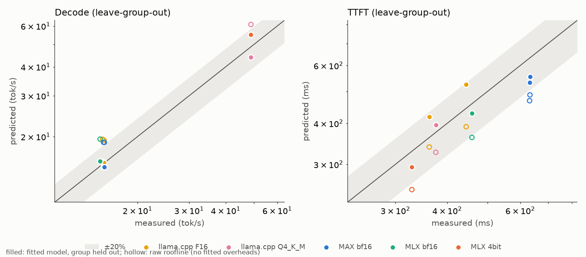
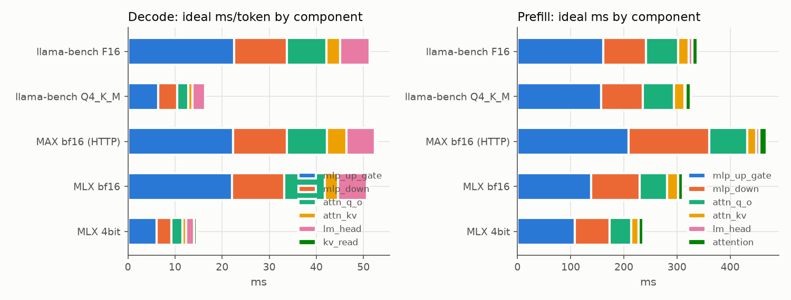
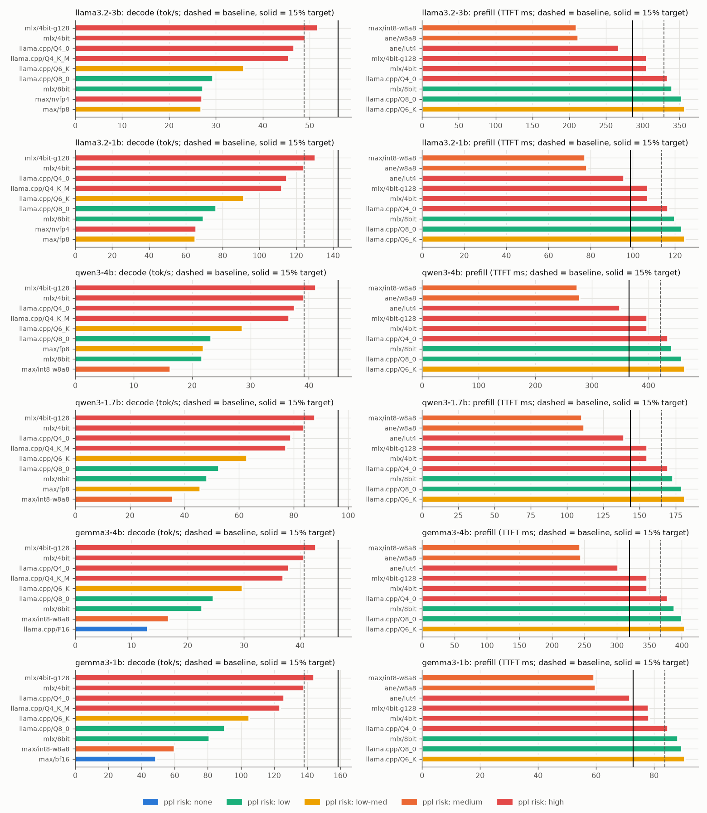
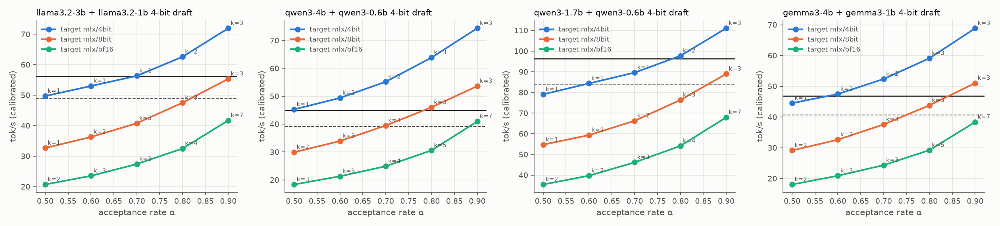
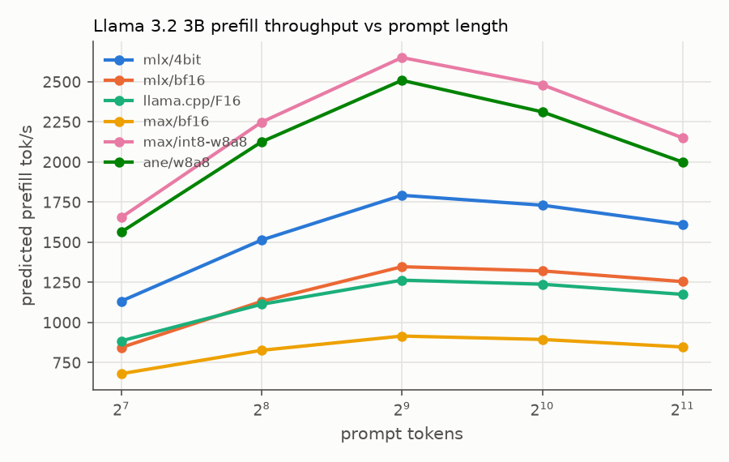

# G2-M2: roofline model for 1-4B LLM inference on Apple M5 (32 GB)

Status: model built and validated against all 7 phase-1 rows. **Completion check passes**: with each runtime/format group held out of the fit in turn, every predicted decode tok/s and TTFT is within 20% of the measured value (worst cases: decode +12.9%, MLX 4-bit; TTFT +18.2%, llama-server F16).
This is a modeling milestone. No benchmarks were run. All numbers come from `atlas/results/*.json` (idle-machine, authoritative) and `bench/results/*.json` (phase 1). Machine-readable output: [results/model.json](results/model.json) (`meta.authoritative: false`).

Reproduce (about 2 s; no GPU work):

```bash
uv run --project /Users/sdawka/Code/llming/roofline python -m roofline.run      # fit, validate, rank, plots -> results/
uv run --project /Users/sdawka/Code/llming/roofline python -m roofline.report   # refresh the generated tables below
```

## 1. Headline findings

1. **Decode runs at about 80% of the atlas GEMV roofline on every runtime.** The fitted efficiency is η_d = 0.81 plus c_d = 1.5 ms/token. All three 16-bit runtimes reach about 98-100 GB/s of effective weight traffic. Isolated cache-cold GEMVs reach 124-131 GB/s. MLX 4-bit is the least efficient: 88 GB/s on 1.81 GB, so its in-model GEMV efficiency is about 0.71. llama.cpp Q4_K_M reads 11% more bytes (2.01 GB, 5.0 bpw) and reaches the same 48.8 tok/s.
2. **Prefill runs at about 84% of the atlas M=512 GEMM rates** (η_p = 0.84). By runtime, llama.cpp is about 0.93 of the model and MLX/MAX about 1.07-1.09 (calibration factors). MAX bf16 prefill is slow because its `apple_m5_mma` kernel on the 3B MLP shapes reaches only 4.8-6.9 TFLOP/s, against 7.9-10.4 TFLOP/s for MLX NAX and about 9 TFLOP/s for ggml.
3. **The 4-bit decode baseline is already near the bandwidth wall.** Any ≥15% decode gain on Llama 3.2 3B must come from **fewer bytes per token** (≤4 bits, high perplexity risk) or **more tokens per weight pass** (speculative decoding). A 4-bit, g128 configuration gives only about +6%.
4. **The roadmap check (≥15% at ≤1% perplexity delta vs bf16) conflicts with the phase-1 baseline.** The best decode baseline (48.8 tok/s) is itself 4-bit. For a 3B model, 4-bit typically costs 2-8% perplexity. An ≤1%-ppl (8-bit) Llama 3.2 3B decodes at about 27-29 tok/s. Reaching 56 tok/s from there needs speculative decoding at an acceptance rate α ≥ 0.9. **Decision needed from the orchestrator** (Section 7).
5. **TTFT: int8 W8A8 prefill is the only ≥15% path with a plausible ≤1% ppl.** It runs on either the GPU Neural Accelerators (MAX `apple_int8_w8a8`, about 210 ms) or the ANE (Core ML w8a8, about 213 ms), against 329 ms measured. Both predict about +55%. Both need engineering. W8A8 is not a MAX pipeline encoding, and the ANE needs a whole-model Core ML conversion. Both carry medium ppl risk from int8 activations.
6. **Qwen3 4B with a Qwen3-0.6B draft is the best speculative-decoding pair.** The draft costs only 12% of an 8-bit target step, against 22% for the Llama 1B/3B pair at 8-bit. 8-bit target + 0.6B draft is predicted at +18% at α = 0.8. Its ppl risk is low.

## 2. Method

### 2.1 Accounting (`roofline/accounting.py`)

The model is read from `config.json` (cached in `configs/`; only configs were downloaded, no weights). The accounting gives:

* Per-layer linears q, k, v, o, gate, up, down (K→N), plus the embedding and lm_head. All six candidates tie the embedding, so the lm_head reads the embedding matrix once per decode token.
* Weight bytes per decode token by format. bpw includes scales:

  | format | bpw |
  |---|---|
  | bf16 | 16 |
  | MLX affine g64 | 4.5 / 8.5 (bf16 scale + bias per 64) |
  | Q8_0 | 8.5 |
  | Q6_K | 6.5625 |
  | Q4_K | 4.5 |
  | Q4_K_M | mixed: Q4_K, with Q6_K for half the attn_v and ffn_down tensors and for the tied embedding/output |
  | NVFP4 | 4.5 (fp8 scale per 16) |
  | FP8 / int8 | 8 |

  The Q4_K_M rule matches the local GGUF header exactly: 2.0115 GB, 5.01 bpw. For MAX FP8/NVFP4/int8, the **lm_head is assumed to stay bf16** (modelopt default), which costs 0.79 GB/token on 3B.
* KV cache: `2·L·n_kv·hd·2 B` per token (fp16). Gemma 3 sliding-window layers (5 local : 1 global, window 512 or 1024) cap the KV span.
* Prefill FLOPs: `2·S·(attn+mlp params)`, plus lm_head for the last token only. Causal attention FLOPs are `4·n_h·hd·Σ keys`, with windows capped.

### 2.2 Predictor (`roofline/predict.py`, `roofline/atlas.py`)

For each weight part, the atlas gives a shape- and dtype-specific achieved rate for the actual kernel family the runtime uses:

| runtime / format | decode (M=1, M=k+1) | prefill (M=512) |
|---|---|---|
| MLX bf16 / 8-bit / 4-bit | `mlx_nax` bf16 / int8w(g64) / int4w(g64), per 3B shape | same |
| llama.cpp F16 / Q8_0 / Q4_K / Q4_0 | `ggml_mtl0` MUL_MAT (4096x14336, one shape for all roles) | same, M=512 |
| llama.cpp Q6_K parts | proxy: mean of Q4_K and Q8_0 per-byte rates (Q6_K not in atlas) | same |
| MAX bf16 | `max_gemv` (apple_gemv) | `max_mma` (apple_m5_mma) |
| MAX NVFP4 / int8 W8A8 | `max_fp4` / `max_int8` | same |
| MAX FP8 W8A16 | proxy: apple_gemv bf16 per-byte rate (FP8 kernel not in atlas) | proxy: max_mma bf16 / 0.9 |
| Core ML ANE w8a8 / w8 / fp16 / lut4 | n/a (decode stays on GPU) | `coreml_CPU_AND_NE` linear chains |

* **Decode** step at M tokens and context `ctx`:
  `t = (Σ_parts bytes·s(M) + KV_read/132 GB/s) / η_d + c_d·L/28`.
  Here s(M) is the atlas seconds per weight byte, interpolated linearly in M between the measured 1/4/16. Rates are shape-specific per role (q/o, k/v, gate/up, down, lm_head).
* **Prefill**: `t = (Σ_parts FLOPs/R(M=512) + attn_FLOPs/(0.5·R_16bit)) / η_p`. TTFT adds method-specific terms; these are not fitted. They come from reading the benchmark code:
  * MLX (`mlx_lm.generate_step`) prefills 511 tokens without the lm_head, then runs one M=1 step for the last prompt token, so its TTFT includes one full decode step.
  * llama-bench `TTFT = 512/pp512` covers a single 512-token ubatch with last-token logits.
  * llama-server receives **513** tokens (the client's 3-digit nonce). That exceeds n_ubatch = 512, so it runs a second 1-token ubatch, which costs one full weight pass (+65 ms at F16).
  * MAX does one prefill pass with LAST_TOKEN logits.
  * HTTP rows add c_http.
* **Speculative decoding**: k draft steps (M=1) plus one target verify at M=k+1, plus 1 ms per iteration of sync/rollback (assumed). Tokens per iteration: E = (1-α^(k+1))/(1-α).

### 2.3 Fitted parameters (only four)

| parameter | value (all rows) | how it was fit | physical meaning |
|---|---:|---|---|
| η_d | 0.814 | relative-error weighted least squares of measured ms/token = ideal/η_d + c_d over the 7 decode rows | in-model GEMV efficiency vs isolated cache-cold GEMV (kernel chaining, norms/rope/attention kernels, clocks) |
| c_d | 1.52 ms/token | same fit (intercept); scaled by L/28 for other depths | per-token fixed cost (dispatch, sampling, host sync) |
| η_p | 0.837 | WLS of (TTFT - method decode steps) = ideal_pf/η_p + c_http·[HTTP] over the 7 TTFT rows | in-model GEMM efficiency at M=512 |
| c_http | 10.4 ms | same fit; **poorly identified** (only 3 HTTP rows, 2 of them the same server); leave-group-out values range from -22 to +42 ms | tokenization + HTTP + scheduling |

There are two non-circular checks. **Leave-group-out (LOGO)** refits all four parameters without one runtime/format group: llama.cpp F16 (llama-bench + llama-server), llama.cpp Q4_K_M, MAX bf16 (endpoint + max benchmark), MLX bf16, and MLX 4-bit. It then predicts that group. The **16-bit-only** fit (η_d only) predicts the two 4-bit rows; this extrapolates across formats.

Runtime calibration factors (measured / fit) are used **only** to anchor the candidate rankings in Section 5. They are never used in validation.

### 2.4 Explicit assumptions (all in `results/model.json` → `assumptions`)

* Attention in prefill runs at 50% of the engine's dense 16-bit GEMM rate. It is 1.5% of 3B prefill FLOPs at S = 512, so the assumption is not critical.
* KV is read once per decode step at the 132 GB/s GPU stream rate.
* Atlas 3B shapes stand in for the other models' roles. This is optimistic for small matrices (Qwen3-0.6B d = 1024, Gemma 1B kv = 256-wide): per-dispatch overhead is under-counted, so small-draft step times are optimistic.
* Rates not in the atlas: MLX g128, Q6_K, MAX FP8 W8A16, MLX int4 at 4 < M < 16 (interpolated; it falls from about 115 GB/s at M=4 to about 31 GB/s at M=16), and prefill at S < 512 (interpolated between M=16 and M=512).
* ANE: atlas linear chains of 8 layers include Python `predict()` overhead. KV handoff from ANE to GPU is not modeled (unified memory). +1 ms per Core ML call is assumed, and the last-token lm_head runs on the GPU.
* Perplexity risks are **literature priors**, not measurements. G2-M3 must measure them (Section 6).

## 3. Validation (completion check)





The validation and fit tables are in Section 8 (generated). Summary:

| metric | raw roofline (no fit) | fit on all rows | leave-group-out | check |
|---|---|---|---|---|
| decode tok/s, max abs error | 41% (all over-predict by 23-41%) | 5.7% | **12.9%** (MLX 4-bit) | **pass** (7/7 within 20%) |
| TTFT, max abs error | 26% (all under-predict) | 11.8% | **18.2%** (llama-server F16) | **pass** (7/7 within 20%) |
| decode, 16-bit-only fit, 4-bit rows | - | - | Q4_K_M -0.9%, MLX 4-bit +11.9% | pass |

Why the misses happen:

* **MLX 4-bit decode (+13% LOGO).** In the model it achieves less of its isolated GEMV rate than the other kernels: 88 GB/s in-model against 126-130 GB/s isolated (η ≈ 0.71 vs 0.78-0.80 for the rest). Without its own row, the fit cannot know this. A chained-GEMV microbenchmark (Section 6, M7) would show whether the cause is the qmv kernels or MLX's per-token graph overhead.
* **llama.cpp Q4_K_M decode (-10% LOGO).** It is the mirror image: llama.cpp extracts more from its kernels than the global η assumes. Also, llama-bench tg128 runs on an **empty** KV cache, while the other rows decode after 512 tokens. The model includes this (ctx 64 vs 576), but it is worth only about 1-2%.
* **TTFT: llama.cpp over-predicted (+5 to +18%), MAX under-predicted (-12 to -16%).** One global η_p cannot capture per-runtime prefill efficiency: llama.cpp reaches about 0.93 of the atlas ggml M=512 rate, MAX about 0.77 of the atlas `max_mma` rate. MAX's graph also includes ops beyond the GEMMs (rope, fused QKV, KV-cache writes), and its TTFT is client-side over HTTP. The llama-server row also depends on the poorly-identified c_http: without the MAX rows it is fit from a single row.
* **Raw roofline vs fitted.** The raw roofline misses by 23-41% on decode. The fitted efficiency is the main result of this milestone: **on this machine, plan on about 80% of atlas GEMV bandwidth in a real decode loop.**

## 4. What MAX can run on the Apple GPU (code reading, no runs)

From `max/pipelines/modeling/config_enums.py` and the arch configs in the pixi env (MAX 26.8.0.dev2026110805):

| arch | `--quantization-encoding` values | notes |
|---|---|---|
| `LlamaForCausalLM` (legacy, `llama3/`) | gptq, q4_k, q4_0, q6_k, float32, bfloat16, float8_e4m3fn, float4_e2m1fnx2 | default q4_k |
| `LlamaForCausalLM_ModuleV3` (**what phase 1 ran**) | float32, bfloat16 | no quantized encodings |
| Qwen3 | bfloat16, float32, float8_e4m3fn | |
| Gemma3 | bfloat16 | |

* `_SUPPORTED_DEVICES`: q4_k / q4_0 / q6_k are **CPU-only**. gptq, float8_e4m3fn, float4_e2m1fnx2 and float6 are GPU.
* `max/nn/_graph_ops/quant.py` has Apple-M5 paths for NVFP4 W4A16 (`matmul.weight.only.block.scaled.apple`; its comments say the supported path so far is the FLUX.2 adapter), FP8 W8A16 (`matmul.weight.only.scaled.float8.apple`, folds a **per-tensor** scale only), and int8 W8A8 (`matmul.int8.w8a8.apple`). int8 W8A8 is **not** an encoding, so using it for Llama needs a custom graph.

This explains why the MAX quantized candidates rank low. The NVFP4 GEMV reaches only 61-99 GB/s at M=1 and **collapses to 9-17 GB/s at M=4/16** (useless for speculative verify). The modelopt-style bf16 lm_head adds 0.79 GB/token. MAX is worth pursuing in G2-M3 **only for int8 W8A8 prefill**.

## 5. Candidate ranking for G2-M3







Baselines: Llama 3.2 3B decode 48.8 tok/s (llama.cpp Q4_K_M = MLX 4-bit). In-process TTFT is 329 ms (MLX 4-bit); HTTP TTFT is 444 ms (llama-server F16). For other models the reference is the calibrated prediction for the same phase-1-style configs, which were **not measured**. Gains below use calibrated predictions.

### Configs that plausibly reach ≥15%

| model | config | metric | predicted | gain | ppl risk | effort / feasibility |
|---|---|---|---:|---:|---|---|
| Llama 3.2 3B | MAX int8 W8A8 prefill (custom graph using `apple_int8_w8a8`) | TTFT | ~210 ms (220 over HTTP) | +57% vs 329 (+100% vs 444 HTTP) | medium | new MAX Llama graph + offline per-channel int8 weights; decode via bf16/4-bit weights in the same or another runtime |
| Llama 3.2 3B | Core ML ANE w8a8 prefill + GPU decode | TTFT | ~213 ms | +55% | medium | whole-model Core ML conversion; ANE compile and placement unverified; frees the GPU for concurrent decode |
| Llama 3.2 3B | ANE LUT-4 prefill | TTFT | ~267 ms | +23% | high | as above |
| Llama 3.2 3B | MLX 4-bit target + Llama 3.2 1B 4-bit draft | decode | 56 / 63 / 72 tok/s at α = 0.7 / 0.8 / 0.9 | +15 / +28 / +48% | high (inherits 4-bit) | `mlx_lm.generate --draft-model`; α unknown on the bench prompt |
| Llama 3.2 3B | MLX 8-bit target + 1B draft | decode | 47.5 / 55.4 tok/s at α = 0.8 / 0.9 | -3 / +14% | low | reaches the target only at α > 0.9 |
| Qwen3 4B | MLX 8-bit target + Qwen3-0.6B 4-bit draft (k=3) | decode | 46 / 54 tok/s at α = 0.8 / 0.9 | +18 / +37% vs predicted 4-bit baseline (39.2) | low | best low-ppl decode candidate; the draft cost is optimistic (small shapes) |
| Qwen3 4B | MLX 4-bit target + 0.6B draft | decode | 55-64 tok/s at α = 0.7-0.8 | +41 / +63% | high | |
| Gemma 3 4B | MLX 8-bit / 4-bit target + Gemma 3 1B draft | decode | 8-bit: 51 tok/s at α = 0.9 (+25%); 4-bit: 52 at α = 0.7 (+29%) | | low / high | the draft carries a 262k-vocab lm_head (30% of its bytes) |
| all six models | int8 W8A8 prefill (MAX GPU or ANE) | TTFT | | +40 to +57% | medium | as above |

### Configs that do **not** reach 15% (predicted)

| config | gain | why |
|---|---:|---|
| MLX 4-bit g128 | +6% decode, +8% TTFT | only removes scale bytes |
| One-pass MLX prefill (skip the extra last-token step) | +6-8% TTFT | about 20 ms; still worth taking as a free fix |
| llama.cpp Q4_0 | -4% | |
| llama.cpp Q8_0 / Q6_K, MLX 8-bit | -26 to -44% decode | |
| MAX FP8 / NVFP4 / int8 decode | -45 to -59% | weak Apple GEMV kernels + bf16 lm_head |
| MAX bf16 prefill | -46% | `apple_m5_mma` MLP-shape rates |
| ANE fp16 / w8 (weight-only) prefill | -17 to -46% | ANE fp16 compute is about 5.5-7.7 TFLOP/s at these shapes |

The full per-model tables are in Section 8.

**Recommendation for G2-M3 (≥2 models):**
1. **Llama 3.2 3B** for continuity with phase 1. Pursue int8 W8A8 prefill for TTFT (GPU NA via MAX first, since it needs no Core ML conversion).
2. **Qwen3 4B** with an 8-bit target and Qwen3-0.6B speculative decoding for decode at low ppl risk.

Measure α first (M4 in Section 6), because every decode candidate depends on it.

## 6. Measurements requested (idle machine, one at a time, AC power)

Expected values are calibrated model predictions; see `results/model.json` → `measurement_requests`. Paths are absolute.

| # | purpose | command | expected |
|---|---|---|---|
| M1 | depth-matched llama.cpp decode (removes the empty-KV advantage) | `/Users/sdawka/Code/llming/llamacpp/src/build/bin/llama-bench -m /Users/sdawka/Code/llming/models/gguf/Llama-3.2-3B-Instruct-Q4_K_M.gguf -p 512 -n 128 -d 0,512 -r 3 -ngl 99 -o json` (repeat with `-F16.gguf`) | Q4_K_M tg 46.7 (d0) → 45.6 (d512); F16 15.7 → 15.6. Model predicts about 2.5% loss at d512; measured d0 is 48.8 |
| M2 | llama-server TTFT without the second 1-token ubatch | `llama-server -m .../Llama-3.2-3B-Instruct-F16.gguf -ngl 99 --port 8001 -c 4096 -b 2048 -ub 1024`, then `run_openai_endpoint.py --base-url http://localhost:8001/v1 --model x --label llama-server-ub1024 --format f16` (as in bench/README.md) | TTFT about 386 ms (was 444). This tests the method-term explanation directly |
| M3 | 8-bit and Q8_0/Q4_0 rows (format extrapolation) | `uv run --project /Users/sdawka/Code/llming/mlx mlx_lm.convert --hf-path /Users/sdawka/Code/llming/models/Llama-3.2-3B-Instruct -q --q-bits 8 --q-group-size 64 --mlx-path /Users/sdawka/Code/llming/models/mlx-Llama-3.2-3B-Instruct-8bit`, then `run_mlx.py --formats /Users/sdawka/Code/llming/models/mlx-Llama-3.2-3B-Instruct-8bit`. `llama-quantize .../Llama-3.2-3B-Instruct-F16.gguf .../Llama-3.2-3B-Instruct-Q8_0.gguf Q8_0` (and Q4_0), then `bash bench/run_llamacpp.sh`-style llama-bench | MLX 8-bit tg 27.2, TTFT 372 ms. Q8_0 tg 29.8, TTFT 353 ms. Q4_0 tg 47.9, TTFT 334 ms |
| M4 | **speculative acceptance α** (decides every decode candidate) | `uv run --project /Users/sdawka/Code/llming/mlx mlx_lm.generate --model /Users/sdawka/Code/llming/models/mlx-Llama-3.2-3B-Instruct-4bit --draft-model mlx-community/Llama-3.2-1B-Instruct-4bit --num-draft-tokens 2 --max-tokens 128 --temp 0 --prompt "$(cat /Users/sdawka/Code/llming/bench/prompt_512.txt)"` (repeat with `--num-draft-tokens 1,3`). Also `llama-speculative -m ...Q4_K_M.gguf -md <Llama-3.2-1B Q4_K_M gguf> --draft-max 3 -ngl 99 -ngld 99 -n 128 --temp 0 -f bench/prompt_512.txt`, which prints the acceptance rate | tok/s ≈ 56 (α = 0.7), 63 (α = 0.8). Report α = accepted/drafted |
| M5 | Llama 3.2 1B baseline (second model, and the draft step cost) | `run_mlx.py --formats <mlx-community/Llama-3.2-1B-Instruct-4bit local path> <...-bf16>` | 4-bit tg 124, TTFT 114 ms; bf16 tg 38, TTFT 165 ms |
| M6 | atlas extension: MLX int4/int8 `quantized_matmul` and MAX `apple_gemv` at M = 2, 3, 5, 6, 8 (verify cost), plus the MAX FP8 W8A16 kernel at M = 1/4/512 | add M ∈ {2,3,5,6,8} to `atlas/shapes.py LLM_M`, rerun `gpu_mlx_default` and `gpu_max` only | at M=4, int4 is about 109-120 GB/s and falls to 31 GB/s by M=16; the knee position decides the best k |
| M7 | in-model efficiency η_d | a chained decode microbenchmark: one MLX graph of 28 × (q, k, v, o, gate, up, down) GEMVs at M=1 with 3B shapes and no attention, timed per token | if about 0.8 × 127 GB/s, η is a kernel-chaining effect; if about 125 GB/s, the loss is in attention/norm/sampling/host |
| M8 | perplexity (the ≤1% gate) | `llama-perplexity -m <each gguf> -f wikitext-2-raw/wiki.test.raw -ngl 99 -c 512` for F16, Q8_0, Q6_K, Q4_K_M; `uv run --project .../mlx python -m mlx_lm.perplexity --model <bf16 / 8bit / 4bit path> --sequence-length 512` | prior: 8-bit about +0.1-0.3%; Q4_K_M about +2-5%; MLX 4-bit about +3-8% |

## 7. Inconsistencies and caveats in the inputs

1. **The baseline violates the gate.** The best phase-1 decode baseline is 4-bit, but the G2-M3 gate requires ≤1% ppl vs bf16. The orchestrator needs to decide whether 4-bit (or calibrated 4-bit: MLX DWQ/AWQ, `mlx_lm.dynamic_quant`, llama.cpp imatrix) counts if M8 shows it is within 1%. If not, the decode target for 3B is effectively unreachable, apart from speculative decoding at α ≥ 0.9 on an 8-bit target.
2. **llama-server TTFT (444 ms) is inflated by about 65 ms.** The client's nonce makes 513 tokens, which is more than n_ubatch = 512, so the server runs a second ubatch that costs one full F16 weight pass. MAX does not chunk at 513, so the HTTP comparison MAX vs llama-server is skewed in llama.cpp's disfavor (M2 tests this).
3. **MLX TTFT includes one full decode step** (mlx_lm processes the last prompt token separately), and pp tok/s = 512/TTFT, so MLX's prefill throughput is under-reported by about 6% (4-bit) and 15% (bf16).
4. **The MAX endpoint run dropped the optional fields** (`ignore_eos`, `min_tokens`, `seed`, `stream_options`, `cache_prompt`). 128 tokens still came back (EOS not hit), but `usage_from_server` = false. The `max benchmark` run had **6% prefix-cache hits**, a mean input of **534** tokens (not 512), and a TTFT std of 129 ms (CI width 22%). Its TTFT is not strictly comparable.
5. **llama-bench tg128 is measured on an empty KV cache**; the other runtimes decode after a 512-token prompt (model: about 1-2.5% advantage).
6. **"Q4_K_M ≈ 4.8 bpw" (bench/README.md) is actually 5.01 bpw** for this file (Q6_K tied embedding plus half of attn_v/ffn_down). The two "4-bit" baselines differ by 11% in bytes and still tie at 48.8 tok/s.
7. **The atlas §10 upper bound (bf16 3B ≈ 21 tok/s, 4-bit ≈ 73) is about 25-40% optimistic.** Use η_d ≈ 0.8. MLX's §6 table mixes units: its M=1 int4 rows are GFLOP/s, while §5 reports GB/s.
8. **Phase 1 ran MAX `LlamaForCausalLM_ModuleV3`, which supports only float32/bfloat16.** Any MAX quantized run must force the legacy `LlamaForCausalLM` arch, and FP8/NVFP4 need pre-quantized checkpoints. Answers to the open question in research.md: on Apple GPU, float8_e4m3fn and float4_e2m1fnx2 are listed. int8 is not an encoding. q4_k/q4_0/q6_k are CPU-only.
9. **The NVFP4 Apple kernel collapses at M = 4-16** (9-17 GB/s), and MLX int4 collapses at M=16 (31 GB/s). Speculative verify windows must stay small (k ≤ 3) until M6 shows where the knee is.
10. **Draft-model step times for very small models (Qwen3-0.6B, Gemma 1B) are probably optimistic.** The atlas has only 3B shapes, and per-dispatch overhead dominates small GEMVs.

## 8. Generated tables

<!-- BEGIN GENERATED -->
### Fitted parameters

| fit | eta_d | c_d (ms/token, 28 layers) | eta_p | c_http (ms) |
|---|---:|---:|---:|---:|
| all 7 rows | 0.814 | 1.52 | 0.837 | 10.4 |
| without MAX bf16 | 0.796 | 1.09 | 0.846 | -22.4 |
| without MLX 4bit | 0.791 | -0.24 | 0.857 | 21.6 |
| without MLX bf16 | 0.825 | 1.77 | 0.851 | 18.8 |
| without llama.cpp F16 | 0.821 | 1.67 | 0.810 | 42.1 |
| without llama.cpp Q4_K_M | 0.832 | 3.04 | 0.826 | 4.5 |
| 16-bit rows only (c_d fixed 0) | 0.794 | 0 | 0.851 | 18.3 |

### Validation: decode tok/s (Llama 3.2 3B, phase-1)

| row | measured | raw roofline | err | fit (all) | err | **leave-group-out** | **err** | 16-bit-only fit | err | check (LOGO, 20%) |
|---|---:|---:|---:|---:|---:|---:|---:|---:|---:|---|
| llama-bench F16 | 15.2 | 19.5 | +28.1% | 15.5 | +1.8% | 15.6 | +2.4% | 15.5 | +1.6% | pass |
| llama-bench Q4_K_M | 48.8 | 60.9 | +24.9% | 46.1 | -5.5% | 43.9 | -9.9% | 48.4 | -0.9% | pass |
| llama-server F16 (HTTP) | 15.4 | 19.3 | +25.7% | 15.4 | -0.1% | 15.4 | +0.4% | 15.3 | -0.3% | pass |
| MAX bf16 (HTTP) | 15.3 | 18.9 | +23.5% | 15.0 | -1.8% | 14.8 | -3.3% | 15.0 | -2.0% | pass |
| max benchmark bf16 (HTTP) | 15.4 | 18.9 | +22.6% | 15.0 | -2.4% | 14.8 | -3.9% | 15.0 | -2.7% | pass |
| MLX bf16 | 14.9 | 19.5 | +30.9% | 15.5 | +4.0% | 15.6 | +5.0% | 15.5 | +3.9% | pass |
| MLX 4bit | 48.8 | 68.7 | +41.0% | 51.6 | +5.7% | 55.1 | +12.9% | 54.6 | +11.9% | pass |

### Validation: TTFT ms

| row | method | measured | raw roofline | err | fit (all) | err | **leave-group-out** | **err** | check (LOGO, 20%) |
|---|---|---:|---:|---:|---:|---:|---:|---:|---|
| llama-bench F16 | llama-bench: TTFT=512/pp512 (one 512-token ubatch, logits for last token); tg128 on empty KV | 362 | 339 | -6.4% | 405 | +11.8% | 418 | +15.5% | pass |
| llama-bench Q4_K_M | llama-bench (as above) | 375 | 326 | -13.0% | 390 | +3.9% | 395 | +5.2% | pass |
| llama-server F16 (HTTP) | HTTP client TTFT; 513 tokens (nonce) > n_ubatch 512 -> second 1-token ubatch = one extra full weight pass | 444 | 391 | -12.1% | 481 | +8.1% | 525 | +18.2% | pass |
| MAX bf16 (HTTP) | HTTP client TTFT, single prefill pass (ReturnLogits.LAST_TOKEN) | 632 | 469 | -25.8% | 571 | -9.7% | 532 | -15.9% | pass |
| max benchmark bf16 (HTTP) | max benchmark random dataset, mean input 534 tok, 6% prefix-cache hits | 633 | 488 | -22.9% | 594 | -6.2% | 555 | -12.4% | pass |
| MLX bf16 | in-process; mlx_lm prefill of 511 tokens (no lm_head) + one M=1 step for the last prompt token | 459 | 362 | -21.0% | 436 | -4.9% | 429 | -6.4% | pass |
| MLX 4bit | in-process; mlx_lm prefill of 511 tokens (no lm_head) + one M=1 step for the last prompt token | 329 | 251 | -23.6% | 302 | -8.0% | 294 | -10.4% | pass |

### Runtime calibration factors (measured / fitted prediction; used only to anchor candidate rankings)

| runtime | decode tok/s factor | TTFT factor | rows |
|---|---:|---:|---|
| mlx | 0.953 | 1.069 | MLX bf16, MLX 4bit |
| llama.cpp | 1.013 | 0.927 | llama-bench F16, llama-bench Q4_K_M, llama-server F16 (HTTP) |
| max | 1.022 | 1.087 | MAX bf16 (HTTP), max benchmark bf16 (HTTP) |
| coreml-ane | 1.000 | 1.000 | none (factor 1) |

### Per-model accounting (text-only; decode GB = weight bytes read per token incl. lm_head)

| model | params (B) | embedding (B) | layers | d / ffn | heads q/kv x hd | vocab | bf16 GB | 8-bit g64 GB | Q4_K_M GB | MLX 4-bit GB | KV KiB/token | KV @8k ctx (MB) | prefill 512 GFLOP (linear / attn) |
|---|---:|---:|---:|---|---|---:|---:|---:|---:|---:|---:|---:|---|
| llama3.2-1b | 1.24 | 0.26 tied | 16 | 2048 / 8192 | 32/8 x 64 | 128256 | 2.47 | 1.31 | 0.80 | 0.70 | 32 | 268 | 997 / 17 |
| llama3.2-3b | 3.21 | 0.39 tied | 28 | 3072 / 8192 | 24/8 x 128 | 128256 | 6.43 | 3.41 | 2.01 | 1.81 | 112 | 940 | 2887 / 45 |
| qwen3-0.6b | 0.60 | 0.16 tied | 28 | 1024 / 3072 | 16/8 x 128 | 151936 | 1.19 | 0.63 | 0.39 | 0.34 | 112 | 940 | 451 / 30 |
| qwen3-1.7b | 1.72 | 0.31 tied | 28 | 2048 / 6144 | 16/8 x 128 | 151936 | 3.44 | 1.83 | 1.10 | 0.97 | 112 | 940 | 1444 / 30 |
| qwen3-4b | 4.02 | 0.39 tied | 36 | 2560 / 9728 | 32/8 x 128 | 151936 | 8.04 | 4.27 | 2.49 | 2.26 | 144 | 1208 | 3721 / 77 |
| gemma3-1b | 1.00 | 0.30 tied | 26 | 1152 / 6912 | 4/1 x 256 (SWA 512, 1 global per 6) | 262144 | 2.00 | 1.06 | 0.67 | 0.56 | 26 | 45 | 715 / 14 |
| gemma3-4b | 3.88 | 0.67 tied | 34 | 2560 / 10240 | 8/4 x 256 (SWA 1024, 1 global per 6) | 262208 | 7.76 | 4.12 | 2.48 | 2.18 | 136 | 289 | 3287 / 37 |

### llama3.2-3b: candidates

Reference: decode 48.8 tok/s, in-process TTFT 329 ms (measured phase-1). 15% target: decode >= 56.1 tok/s, TTFT <= 286 ms.

| decode config | weights GB | pred tok/s (raw) | calibrated | gain | >=15%? | ppl risk (prior) | support / proxy |
|---|---:|---:|---:|---:|---|---|---|
| mlx/4bit-g128 | 1.71 | 54.3 | 51.7 | +6.0% | no | high: ~+4-10% | proxy: g128 kernel unmeasured: g64 per-byte rate used |
| mlx/4bit | 1.81 | 51.6 | 49.2 | +0.8% | no | high: ~+3-8% |  |
| llama.cpp/Q4_0 | 1.91 | 46.1 | 46.7 | -4.2% | no | high: ~+4-10% | proxy: Q6_K output: mean of Q4_K/Q8_0 rates |
| llama.cpp/Q4_K_M | 2.01 | 45.0 | 45.6 | -6.6% | no | high: ~+2-5% (small models are more sensitive) | proxy: Q6_K parts: mean of Q4_K/Q8_0 rates |
| llama.cpp/Q6_K | 2.64 | 35.5 | 35.9 | -26.4% | no | low-med: ~+0.3-0.8% | proxy: Q6_K unmeasured: mean of Q4_K/Q8_0 per-byte rates |
| llama.cpp/Q8_0 | 3.32 | 29.0 | 29.4 | -39.8% | no | low: ~+0.1-0.3% | proxy: Q6_K output tensor: mean of Q4_K/Q8_0 rates |
| mlx/8bit | 3.41 | 28.6 | 27.2 | -44.2% | no | low: ~+0.1-0.3% |  |
| max/nvfp4 | 2.37 | 26.5 | 27.1 | -44.5% | no | high: ~+3-6% (PTQ, no calibration) | encoding float4_e2m1fnx2 listed for legacy Llama3 arch; Apple W4A16 path only exercised by FLUX.2 so far; needs NVFP4 (modelopt) checkpoint |
| max/fp8 | 3.61 | 26.3 | 26.9 | -44.9% | no | low-med: ~+0.2-1% (per-tensor scale only on the Apple path) | encoding float8_e4m3fn listed for legacy Llama3 arch (not ModuleV3); needs an FP8 checkpoint with per-tensor scale; proxy: FP8 W8A16 Apple kernel not in atlas: bf16 GEMV per-byte rate (decode) and bf16 MMA rate x1/0.9 (prefill, dequant to transient bf16) assumed |
| max/int8-w8a8 | 3.61 | 19.8 | 20.2 | -58.5% | no | medium: ~+0.5-2% (dynamic per-token int8 activations; Llama-3 activation outliers) | NOT a pipeline encoding: op exists (max.nn quant int8 W8A8, Apple M5 only); needs a custom Llama graph + offline weight quantization |
| llama.cpp/F16 | 6.43 | 15.4 | 15.6 | -68.1% | no | none: ~0% |  |
| max/bf16 | 6.43 | 15.0 | 15.4 | -68.5% | no | none: 0% |  |
| mlx/bf16 | 6.43 | 15.5 | 14.8 | -69.7% | no | none: 0% |  |

| TTFT config (512-token prompt) | pred ms (raw) | calibrated in-process | calibrated HTTP | gain | >=15%? | ppl risk (prior) | support / proxy |
|---|---:|---:|---:|---:|---|---|---|
| max/int8-w8a8 (one pass, last-token logits) | 193 | 210 | 220 | +56.8% | yes | medium | NOT a pipeline encoding: op exists (max.nn quant int8 W8A8, Apple M5 only); needs a custom Llama graph + offline weight quantization |
| ane/w8a8 (one pass, last-token logits) | 213 | 213 | 223 | +54.7% | yes | medium | whole-model Core ML conversion required (coremltools); not tried; proxy: ANE shapes are 3B attn_q_o / mlp_up_down chains of 8 linears; attention on ANE assumed at 50% of ANE fp16 linear rate; KV handoff to GPU not modeled (unified memory) |
| ane/lut4 (one pass, last-token logits) | 267 | 267 | 278 | +23.0% | yes | high | whole-model Core ML conversion required (coremltools); not tried; proxy: ANE shapes are 3B attn_q_o / mlp_up_down chains of 8 linears; attention on ANE assumed at 50% of ANE fp16 linear rate; KV handoff to GPU not modeled (unified memory) |
| mlx/4bit-g128 (one pass, last-token logits) | 285 | 305 | 316 | +7.8% | no | high | proxy: g128 kernel unmeasured: g64 per-byte rate used |
| mlx/4bit (one pass, last-token logits) | 286 | 305 | 316 | +7.7% | no | high |  |
| mlx/4bit (mlx_lm as benchmarked: +1 decode step) | 302 | 323 | - | +1.7% | no | high |  |
| llama.cpp/Q4_0 (one pass, last-token logits) | 361 | 334 | 344 | -1.5% | no | high | proxy: Q6_K output: mean of Q4_K/Q8_0 rates |
| mlx/8bit (one pass, last-token logits) | 318 | 340 | 350 | -3.1% | no | low |  |
| llama.cpp/Q8_0 (one pass, last-token logits) | 381 | 353 | 363 | -6.7% | no | low | proxy: Q6_K output tensor: mean of Q4_K/Q8_0 rates |
| llama.cpp/Q6_K (one pass, last-token logits) | 386 | 357 | 368 | -8.0% | no | low-med | proxy: Q6_K unmeasured: mean of Q4_K/Q8_0 per-byte rates |
| llama.cpp/Q4_K_M (one pass, last-token logits) | 390 | 362 | 372 | -9.0% | no | high | proxy: Q6_K parts: mean of Q4_K/Q8_0 rates |
| mlx/8bit (mlx_lm as benchmarked: +1 decode step) | 348 | 372 | - | -11.6% | no | low |  |
| llama.cpp/F16 (one pass, last-token logits) | 405 | 375 | 386 | -12.3% | no | none |  |
| ane/w8 (one pass, last-token logits) | 398 | 398 | 408 | -17.3% | no | low-med | whole-model Core ML conversion required (coremltools); not tried; proxy: ANE shapes are 3B attn_q_o / mlp_up_down chains of 8 linears; attention on ANE assumed at 50% of ANE fp16 linear rate; KV handoff to GPU not modeled (unified memory) |
| mlx/bf16 (one pass, last-token logits) | 380 | 406 | 417 | -19.0% | no | none |  |
| mlx/bf16 (mlx_lm as benchmarked: +1 decode step) | 436 | 467 | - | -29.5% | no | none |  |
| max/bf16 (one pass, last-token logits) | 559 | 608 | 618 | -45.8% | no | none |  |
| ane/fp16 (one pass, last-token logits) | 609 | 609 | 620 | -46.0% | no | none | whole-model Core ML conversion required (coremltools); not tried; proxy: ANE shapes are 3B attn_q_o / mlp_up_down chains of 8 linears; attention on ANE assumed at 50% of ANE fp16 linear rate; KV handoff to GPU not modeled (unified memory) |
| max/nvfp4 (one pass, last-token logits) | 568 | 617 | 627 | -46.6% | no | high | encoding float4_e2m1fnx2 listed for legacy Llama3 arch; Apple W4A16 path only exercised by FLUX.2 so far; needs NVFP4 (modelopt) checkpoint |
| max/fp8 (one pass, last-token logits) | 619 | 672 | 683 | -51.1% | no | low-med | encoding float8_e4m3fn listed for legacy Llama3 arch (not ModuleV3); needs an FP8 checkpoint with per-tensor scale; proxy: FP8 W8A16 Apple kernel not in atlas: bf16 GEMV per-byte rate (decode) and bf16 MMA rate x1/0.9 (prefill, dequant to transient bf16) assumed |

Speculative decoding (draft llama3.2-1b MLX 4-bit; best k per alpha; calibrated tok/s and gain):

| target | alpha=0.5 | alpha=0.6 | alpha=0.7 | alpha=0.8 | alpha=0.9 |
|---|---:|---:|---:|---:|---:|
| mlx/4bit | 49.7 (k=1, +1.9%) | 53.0 (k=1, +8.7%) | 56.3 (k=1, +15.5%) | 62.6 (k=2, +28.3%) | 72.0 (k=3, +47.5%) |
| mlx/8bit | 32.7 (k=1, -33.0%) | 36.3 (k=2, -25.6%) | 40.8 (k=3, -16.4%) | 47.5 (k=3, -2.6%) | 55.4 (k=3, +13.5%) |
| mlx/bf16 | 20.7 (k=2, -57.6%) | 23.6 (k=3, -51.7%) | 27.4 (k=3, -43.8%) | 32.5 (k=4, -33.4%) | 41.7 (k=7, -14.5%) |

Draft step 7.7 ms; target step (M=1) for reference is in the decode table.

### llama3.2-1b: candidates

Reference: decode 124.2 tok/s, in-process TTFT 114 ms (calibrated prediction of phase-1-style configs (MLX 4-bit / llama.cpp Q4_K_M), not measured). 15% target: decode >= 142.8 tok/s, TTFT <= 99 ms.

| decode config | weights GB | pred tok/s (raw) | calibrated | gain | >=15%? | ppl risk (prior) | support / proxy |
|---|---:|---:|---:|---:|---|---|---|
| mlx/4bit-g128 | 0.66 | 136.8 | 130.4 | +5.0% | no | high: ~+4-10% | proxy: g128 kernel unmeasured: g64 per-byte rate used |
| mlx/4bit | 0.70 | 130.3 | 124.2 | +0.0% | no | high: ~+3-8% |  |
| llama.cpp/Q4_0 | 0.76 | 113.4 | 114.9 | -7.5% | no | high: ~+4-10% | proxy: Q6_K output: mean of Q4_K/Q8_0 rates |
| llama.cpp/Q4_K_M | 0.80 | 110.8 | 112.3 | -9.6% | no | high: ~+2-5% (small models are more sensitive) | proxy: Q6_K parts: mean of Q4_K/Q8_0 rates |
| llama.cpp/Q6_K | 1.01 | 90.3 | 91.5 | -26.3% | no | low-med: ~+0.3-0.8% | proxy: Q6_K unmeasured: mean of Q4_K/Q8_0 per-byte rates |
| llama.cpp/Q8_0 | 1.25 | 75.5 | 76.5 | -38.4% | no | low: ~+0.1-0.3% | proxy: Q6_K output tensor: mean of Q4_K/Q8_0 rates |
| mlx/8bit | 1.31 | 73.1 | 69.7 | -43.9% | no | low: ~+0.1-0.3% |  |
| max/nvfp4 | 1.07 | 64.2 | 65.6 | -47.2% | no | high: ~+3-6% (PTQ, no calibration) | encoding float4_e2m1fnx2 listed for legacy Llama3 arch; Apple W4A16 path only exercised by FLUX.2 so far; needs NVFP4 (modelopt) checkpoint |
| max/fp8 | 1.50 | 63.8 | 65.2 | -47.5% | no | low-med: ~+0.2-1% (per-tensor scale only on the Apple path) | encoding float8_e4m3fn listed for legacy Llama3 arch (not ModuleV3); needs an FP8 checkpoint with per-tensor scale; proxy: FP8 W8A16 Apple kernel not in atlas: bf16 GEMV per-byte rate (decode) and bf16 MMA rate x1/0.9 (prefill, dequant to transient bf16) assumed |
| max/int8-w8a8 | 1.50 | 50.3 | 51.4 | -58.6% | no | medium: ~+0.5-2% (dynamic per-token int8 activations; Llama-3 activation outliers) | NOT a pipeline encoding: op exists (max.nn quant int8 W8A8, Apple M5 only); needs a custom Llama graph + offline weight quantization |
| max/bf16 | 2.47 | 39.4 | 40.3 | -67.6% | no | none: 0% |  |
| llama.cpp/F16 | 2.47 | 39.6 | 40.1 | -67.7% | no | none: ~0% |  |
| mlx/bf16 | 2.47 | 40.0 | 38.2 | -69.3% | no | none: 0% |  |

| TTFT config (512-token prompt) | pred ms (raw) | calibrated in-process | calibrated HTTP | gain | >=15%? | ppl risk (prior) | support / proxy |
|---|---:|---:|---:|---:|---|---|---|
| max/int8-w8a8 (one pass, last-token logits) | 71 | 77 | 88 | +47.2% | yes | medium | NOT a pipeline encoding: op exists (max.nn quant int8 W8A8, Apple M5 only); needs a custom Llama graph + offline weight quantization |
| ane/w8a8 (one pass, last-token logits) | 78 | 78 | 89 | +45.3% | yes | medium | whole-model Core ML conversion required (coremltools); not tried; proxy: ANE shapes are 3B attn_q_o / mlp_up_down chains of 8 linears; attention on ANE assumed at 50% of ANE fp16 linear rate; KV handoff to GPU not modeled (unified memory) |
| ane/lut4 (one pass, last-token logits) | 96 | 96 | 106 | +18.6% | yes | high | whole-model Core ML conversion required (coremltools); not tried; proxy: ANE shapes are 3B attn_q_o / mlp_up_down chains of 8 linears; attention on ANE assumed at 50% of ANE fp16 linear rate; KV handoff to GPU not modeled (unified memory) |
| mlx/4bit-g128 (one pass, last-token logits) | 100 | 107 | 117 | +6.2% | no | high | proxy: g128 kernel unmeasured: g64 per-byte rate used |
| mlx/4bit (one pass, last-token logits) | 100 | 107 | 118 | +6.1% | no | high |  |
| mlx/4bit (mlx_lm as benchmarked: +1 decode step) | 106 | 114 | - | +0.0% | no | high |  |
| llama.cpp/Q4_0 (one pass, last-token logits) | 126 | 117 | 127 | -2.6% | no | high | proxy: Q6_K output: mean of Q4_K/Q8_0 rates |
| mlx/8bit (one pass, last-token logits) | 112 | 120 | 130 | -5.3% | no | low |  |
| llama.cpp/Q8_0 (one pass, last-token logits) | 133 | 123 | 134 | -7.7% | no | low | proxy: Q6_K output tensor: mean of Q4_K/Q8_0 rates |
| llama.cpp/Q6_K (one pass, last-token logits) | 135 | 125 | 135 | -8.9% | no | low-med | proxy: Q6_K unmeasured: mean of Q4_K/Q8_0 per-byte rates |
| llama.cpp/Q4_K_M (one pass, last-token logits) | 136 | 126 | 137 | -9.9% | no | high | proxy: Q6_K parts: mean of Q4_K/Q8_0 rates |
| mlx/8bit (mlx_lm as benchmarked: +1 decode step) | 123 | 132 | - | -13.7% | no | low |  |
| llama.cpp/F16 (one pass, last-token logits) | 143 | 132 | 143 | -14.0% | no | none |  |
| mlx/bf16 (one pass, last-token logits) | 134 | 144 | 154 | -20.9% | no | none |  |
| ane/w8 (one pass, last-token logits) | 144 | 144 | 155 | -21.2% | no | low-med | whole-model Core ML conversion required (coremltools); not tried; proxy: ANE shapes are 3B attn_q_o / mlp_up_down chains of 8 linears; attention on ANE assumed at 50% of ANE fp16 linear rate; KV handoff to GPU not modeled (unified memory) |
| mlx/bf16 (mlx_lm as benchmarked: +1 decode step) | 154 | 165 | - | -31.1% | no | none |  |
| max/nvfp4 (one pass, last-token logits) | 198 | 216 | 226 | -47.3% | no | high | encoding float4_e2m1fnx2 listed for legacy Llama3 arch; Apple W4A16 path only exercised by FLUX.2 so far; needs NVFP4 (modelopt) checkpoint |
| max/bf16 (one pass, last-token logits) | 201 | 218 | 228 | -47.8% | no | none |  |
| ane/fp16 (one pass, last-token logits) | 219 | 219 | 229 | -48.1% | no | none | whole-model Core ML conversion required (coremltools); not tried; proxy: ANE shapes are 3B attn_q_o / mlp_up_down chains of 8 linears; attention on ANE assumed at 50% of ANE fp16 linear rate; KV handoff to GPU not modeled (unified memory) |
| max/fp8 (one pass, last-token logits) | 222 | 241 | 251 | -52.8% | no | low-med | encoding float8_e4m3fn listed for legacy Llama3 arch (not ModuleV3); needs an FP8 checkpoint with per-tensor scale; proxy: FP8 W8A16 Apple kernel not in atlas: bf16 GEMV per-byte rate (decode) and bf16 MMA rate x1/0.9 (prefill, dequant to transient bf16) assumed |

### qwen3-4b: candidates

Reference: decode 39.2 tok/s, in-process TTFT 421 ms (calibrated prediction of phase-1-style configs (MLX 4-bit / llama.cpp Q4_K_M), not measured). 15% target: decode >= 45.0 tok/s, TTFT <= 366 ms.

| decode config | weights GB | pred tok/s (raw) | calibrated | gain | >=15%? | ppl risk (prior) | support / proxy |
|---|---:|---:|---:|---:|---|---|---|
| mlx/4bit-g128 | 2.14 | 43.2 | 41.2 | +5.2% | no | high: ~+4-10% | proxy: g128 kernel unmeasured: g64 per-byte rate used |
| mlx/4bit | 2.26 | 41.1 | 39.2 | +0.0% | no | high: ~+3-8% |  |
| llama.cpp/Q4_0 | 2.36 | 37.1 | 37.6 | -4.1% | no | high: ~+4-10% | proxy: Q6_K output: mean of Q4_K/Q8_0 rates |
| llama.cpp/Q4_K_M | 2.49 | 36.2 | 36.7 | -6.4% | no | high: ~+2-5% (small models are more sensitive) | proxy: Q6_K parts: mean of Q4_K/Q8_0 rates |
| llama.cpp/Q6_K | 3.30 | 28.3 | 28.6 | -26.9% | no | low-med: ~+0.3-0.8% | proxy: Q6_K unmeasured: mean of Q4_K/Q8_0 per-byte rates |
| llama.cpp/Q8_0 | 4.18 | 23.0 | 23.3 | -40.5% | no | low: ~+0.1-0.3% | proxy: Q6_K output tensor: mean of Q4_K/Q8_0 rates |
| max/fp8 | 4.41 | 21.5 | 21.9 | -44.0% | no | low-med: ~+0.2-1% (per-tensor scale only on the Apple path) | encoding float8_e4m3fn listed for legacy Llama3 arch (not ModuleV3); needs an FP8 checkpoint with per-tensor scale; proxy: FP8 W8A16 Apple kernel not in atlas: bf16 GEMV per-byte rate (decode) and bf16 MMA rate x1/0.9 (prefill, dequant to transient bf16) assumed |
| mlx/8bit | 4.27 | 22.8 | 21.7 | -44.6% | no | low: ~+0.1-0.3% |  |
| max/int8-w8a8 | 4.41 | 16.0 | 16.3 | -58.3% | no | medium: ~+0.5-2% (dynamic per-token int8 activations; Llama-3 activation outliers) | NOT a pipeline encoding: op exists (max.nn quant int8 W8A8, Apple M5 only); needs a custom Llama graph + offline weight quantization |
| llama.cpp/F16 | 8.04 | 12.3 | 12.4 | -68.3% | no | none: ~0% |  |
| max/bf16 | 8.04 | 12.0 | 12.3 | -68.6% | no | none: 0% |  |
| mlx/bf16 | 8.04 | 12.4 | 11.8 | -69.9% | no | none: 0% |  |

| TTFT config (512-token prompt) | pred ms (raw) | calibrated in-process | calibrated HTTP | gain | >=15%? | ppl risk (prior) | support / proxy |
|---|---:|---:|---:|---:|---|---|---|
| max/int8-w8a8 (one pass, last-token logits) | 253 | 275 | 285 | +53.2% | yes | medium | NOT a pipeline encoding: op exists (max.nn quant int8 W8A8, Apple M5 only); needs a custom Llama graph + offline weight quantization |
| ane/w8a8 (one pass, last-token logits) | 278 | 278 | 289 | +51.2% | yes | medium | whole-model Core ML conversion required (coremltools); not tried; proxy: ANE shapes are 3B attn_q_o / mlp_up_down chains of 8 linears; attention on ANE assumed at 50% of ANE fp16 linear rate; KV handoff to GPU not modeled (unified memory) |
| ane/lut4 (one pass, last-token logits) | 350 | 350 | 360 | +20.4% | yes | high | whole-model Core ML conversion required (coremltools); not tried; proxy: ANE shapes are 3B attn_q_o / mlp_up_down chains of 8 linears; attention on ANE assumed at 50% of ANE fp16 linear rate; KV handoff to GPU not modeled (unified memory) |
| mlx/4bit-g128 (one pass, last-token logits) | 372 | 398 | 408 | +5.8% | no | high | proxy: g128 kernel unmeasured: g64 per-byte rate used |
| mlx/4bit (one pass, last-token logits) | 372 | 398 | 408 | +5.8% | no | high |  |
| mlx/4bit (mlx_lm as benchmarked: +1 decode step) | 394 | 421 | - | +0.0% | no | high |  |
| llama.cpp/Q4_0 (one pass, last-token logits) | 469 | 434 | 445 | -3.1% | no | high | proxy: Q6_K output: mean of Q4_K/Q8_0 rates |
| mlx/8bit (one pass, last-token logits) | 413 | 441 | 452 | -4.6% | no | low |  |
| llama.cpp/Q8_0 (one pass, last-token logits) | 495 | 459 | 469 | -8.2% | no | low | proxy: Q6_K output tensor: mean of Q4_K/Q8_0 rates |
| llama.cpp/Q6_K (one pass, last-token logits) | 502 | 465 | 475 | -9.4% | no | low-med | proxy: Q6_K unmeasured: mean of Q4_K/Q8_0 per-byte rates |
| llama.cpp/Q4_K_M (one pass, last-token logits) | 507 | 470 | 480 | -10.4% | no | high | proxy: Q6_K parts: mean of Q4_K/Q8_0 rates |
| mlx/8bit (mlx_lm as benchmarked: +1 decode step) | 452 | 483 | - | -12.9% | no | low |  |
| llama.cpp/F16 (one pass, last-token logits) | 525 | 486 | 497 | -13.5% | no | none |  |
| ane/w8 (one pass, last-token logits) | 516 | 516 | 526 | -18.4% | no | low-med | whole-model Core ML conversion required (coremltools); not tried; proxy: ANE shapes are 3B attn_q_o / mlp_up_down chains of 8 linears; attention on ANE assumed at 50% of ANE fp16 linear rate; KV handoff to GPU not modeled (unified memory) |
| mlx/bf16 (one pass, last-token logits) | 491 | 525 | 535 | -19.8% | no | none |  |
| mlx/bf16 (mlx_lm as benchmarked: +1 decode step) | 563 | 603 | - | -30.1% | no | none |  |
| ane/fp16 (one pass, last-token logits) | 788 | 788 | 798 | -46.6% | no | none | whole-model Core ML conversion required (coremltools); not tried; proxy: ANE shapes are 3B attn_q_o / mlp_up_down chains of 8 linears; attention on ANE assumed at 50% of ANE fp16 linear rate; KV handoff to GPU not modeled (unified memory) |
| max/bf16 (one pass, last-token logits) | 726 | 789 | 799 | -46.6% | no | none |  |
| max/fp8 (one pass, last-token logits) | 803 | 872 | 883 | -51.7% | no | low-med | encoding float8_e4m3fn listed for legacy Llama3 arch (not ModuleV3); needs an FP8 checkpoint with per-tensor scale; proxy: FP8 W8A16 Apple kernel not in atlas: bf16 GEMV per-byte rate (decode) and bf16 MMA rate x1/0.9 (prefill, dequant to transient bf16) assumed |

Speculative decoding (draft qwen3-0.6b MLX 4-bit; best k per alpha; calibrated tok/s and gain):

| target | alpha=0.5 | alpha=0.6 | alpha=0.7 | alpha=0.8 | alpha=0.9 |
|---|---:|---:|---:|---:|---:|
| mlx/4bit | 45.3 (k=1, +15.7%) | 49.4 (k=2, +26.1%) | 55.2 (k=2, +41.0%) | 63.9 (k=3, +63.1%) | 74.4 (k=3, +90.0%) |
| mlx/8bit | 29.9 (k=2, -23.6%) | 33.9 (k=3, -13.3%) | 39.5 (k=3, +0.9%) | 46.0 (k=3, +17.6%) | 53.6 (k=3, +37.0%) |
| mlx/bf16 | 18.4 (k=3, -53.1%) | 21.3 (k=3, -45.6%) | 24.9 (k=4, -36.4%) | 30.6 (k=5, -21.9%) | 41.0 (k=7, +4.6%) |

Draft step 5.3 ms; target step (M=1) for reference is in the decode table.

### qwen3-1.7b: candidates

Reference: decode 83.8 tok/s, in-process TTFT 165 ms (calibrated prediction of phase-1-style configs (MLX 4-bit / llama.cpp Q4_K_M), not measured). 15% target: decode >= 96.3 tok/s, TTFT <= 144 ms.

| decode config | weights GB | pred tok/s (raw) | calibrated | gain | >=15%? | ppl risk (prior) | support / proxy |
|---|---:|---:|---:|---:|---|---|---|
| mlx/4bit-g128 | 0.91 | 92.0 | 87.7 | +4.7% | no | high: ~+4-10% | proxy: g128 kernel unmeasured: g64 per-byte rate used |
| mlx/4bit | 0.97 | 87.9 | 83.8 | +0.0% | no | high: ~+3-8% |  |
| llama.cpp/Q4_0 | 1.05 | 77.9 | 79.0 | -5.8% | no | high: ~+4-10% | proxy: Q6_K output: mean of Q4_K/Q8_0 rates |
| llama.cpp/Q4_K_M | 1.10 | 76.2 | 77.2 | -7.9% | no | high: ~+2-5% (small models are more sensitive) | proxy: Q6_K parts: mean of Q4_K/Q8_0 rates |
| llama.cpp/Q6_K | 1.41 | 62.1 | 63.0 | -24.9% | no | low-med: ~+0.3-0.8% | proxy: Q6_K unmeasured: mean of Q4_K/Q8_0 per-byte rates |
| llama.cpp/Q8_0 | 1.75 | 52.0 | 52.6 | -37.2% | no | low: ~+0.1-0.3% | proxy: Q6_K output tensor: mean of Q4_K/Q8_0 rates |
| mlx/8bit | 1.83 | 50.7 | 48.3 | -42.4% | no | low: ~+0.1-0.3% |  |
| max/fp8 | 2.03 | 44.8 | 45.7 | -45.4% | no | low-med: ~+0.2-1% (per-tensor scale only on the Apple path) | encoding float8_e4m3fn listed for legacy Llama3 arch (not ModuleV3); needs an FP8 checkpoint with per-tensor scale; proxy: FP8 W8A16 Apple kernel not in atlas: bf16 GEMV per-byte rate (decode) and bf16 MMA rate x1/0.9 (prefill, dequant to transient bf16) assumed |
| max/int8-w8a8 | 2.03 | 34.9 | 35.7 | -57.4% | no | medium: ~+0.5-2% (dynamic per-token int8 activations; Llama-3 activation outliers) | NOT a pipeline encoding: op exists (max.nn quant int8 W8A8, Apple M5 only); needs a custom Llama graph + offline weight quantization |
| llama.cpp/F16 | 3.44 | 27.9 | 28.2 | -66.3% | no | none: ~0% |  |
| max/bf16 | 3.44 | 27.2 | 27.8 | -66.8% | no | none: 0% |  |
| mlx/bf16 | 3.44 | 28.2 | 26.9 | -67.9% | no | none: 0% |  |

| TTFT config (512-token prompt) | pred ms (raw) | calibrated in-process | calibrated HTTP | gain | >=15%? | ppl risk (prior) | support / proxy |
|---|---:|---:|---:|---:|---|---|---|
| max/int8-w8a8 (one pass, last-token logits) | 102 | 110 | 121 | +49.8% | yes | medium | NOT a pipeline encoding: op exists (max.nn quant int8 W8A8, Apple M5 only); needs a custom Llama graph + offline weight quantization |
| ane/w8a8 (one pass, last-token logits) | 112 | 112 | 122 | +47.8% | yes | medium | whole-model Core ML conversion required (coremltools); not tried; proxy: ANE shapes are 3B attn_q_o / mlp_up_down chains of 8 linears; attention on ANE assumed at 50% of ANE fp16 linear rate; KV handoff to GPU not modeled (unified memory) |
| ane/lut4 (one pass, last-token logits) | 139 | 139 | 150 | +18.7% | yes | high | whole-model Core ML conversion required (coremltools); not tried; proxy: ANE shapes are 3B attn_q_o / mlp_up_down chains of 8 linears; attention on ANE assumed at 50% of ANE fp16 linear rate; KV handoff to GPU not modeled (unified memory) |
| mlx/4bit-g128 (one pass, last-token logits) | 145 | 155 | 166 | +6.6% | no | high | proxy: g128 kernel unmeasured: g64 per-byte rate used |
| mlx/4bit (one pass, last-token logits) | 145 | 155 | 166 | +6.5% | no | high |  |
| mlx/4bit (mlx_lm as benchmarked: +1 decode step) | 155 | 165 | - | +0.0% | no | high |  |
| llama.cpp/Q4_0 (one pass, last-token logits) | 183 | 170 | 180 | -2.5% | no | high | proxy: Q6_K output: mean of Q4_K/Q8_0 rates |
| mlx/8bit (one pass, last-token logits) | 162 | 173 | 183 | -4.4% | no | low |  |
| llama.cpp/Q8_0 (one pass, last-token logits) | 193 | 179 | 189 | -7.6% | no | low | proxy: Q6_K output tensor: mean of Q4_K/Q8_0 rates |
| llama.cpp/Q6_K (one pass, last-token logits) | 196 | 181 | 192 | -8.8% | no | low-med | proxy: Q6_K unmeasured: mean of Q4_K/Q8_0 per-byte rates |
| llama.cpp/Q4_K_M (one pass, last-token logits) | 198 | 183 | 194 | -9.8% | no | high | proxy: Q6_K parts: mean of Q4_K/Q8_0 rates |
| mlx/8bit (mlx_lm as benchmarked: +1 decode step) | 178 | 191 | - | -13.2% | no | low |  |
| llama.cpp/F16 (one pass, last-token logits) | 207 | 192 | 202 | -13.6% | no | none |  |
| ane/w8 (one pass, last-token logits) | 204 | 204 | 215 | -19.1% | no | low-med | whole-model Core ML conversion required (coremltools); not tried; proxy: ANE shapes are 3B attn_q_o / mlp_up_down chains of 8 linears; attention on ANE assumed at 50% of ANE fp16 linear rate; KV handoff to GPU not modeled (unified memory) |
| mlx/bf16 (one pass, last-token logits) | 195 | 208 | 219 | -20.5% | no | none |  |
| mlx/bf16 (mlx_lm as benchmarked: +1 decode step) | 224 | 239 | - | -30.9% | no | none |  |
| max/bf16 (one pass, last-token logits) | 283 | 308 | 318 | -46.2% | no | none |  |
| ane/fp16 (one pass, last-token logits) | 310 | 310 | 321 | -46.7% | no | none | whole-model Core ML conversion required (coremltools); not tried; proxy: ANE shapes are 3B attn_q_o / mlp_up_down chains of 8 linears; attention on ANE assumed at 50% of ANE fp16 linear rate; KV handoff to GPU not modeled (unified memory) |
| max/fp8 (one pass, last-token logits) | 313 | 340 | 350 | -51.3% | no | low-med | encoding float8_e4m3fn listed for legacy Llama3 arch (not ModuleV3); needs an FP8 checkpoint with per-tensor scale; proxy: FP8 W8A16 Apple kernel not in atlas: bf16 GEMV per-byte rate (decode) and bf16 MMA rate x1/0.9 (prefill, dequant to transient bf16) assumed |

Speculative decoding (draft qwen3-0.6b MLX 4-bit; best k per alpha; calibrated tok/s and gain):

| target | alpha=0.5 | alpha=0.6 | alpha=0.7 | alpha=0.8 | alpha=0.9 |
|---|---:|---:|---:|---:|---:|
| mlx/4bit | 79.1 (k=1, -5.6%) | 84.4 (k=1, +0.7%) | 89.6 (k=1, +7.0%) | 97.7 (k=2, +16.7%) | 111.1 (k=3, +32.6%) |
| mlx/8bit | 54.8 (k=1, -34.6%) | 59.4 (k=2, -29.1%) | 66.3 (k=2, -20.8%) | 76.4 (k=3, -8.8%) | 89.0 (k=3, +6.2%) |
| mlx/bf16 | 35.5 (k=2, -57.6%) | 39.7 (k=2, -52.6%) | 46.2 (k=3, -44.9%) | 54.2 (k=4, -35.4%) | 68.0 (k=7, -18.9%) |

Draft step 5.3 ms; target step (M=1) for reference is in the decode table.

### gemma3-4b: candidates

Reference: decode 40.7 tok/s, in-process TTFT 367 ms (calibrated prediction of phase-1-style configs (MLX 4-bit / llama.cpp Q4_K_M), not measured). 15% target: decode >= 46.8 tok/s, TTFT <= 320 ms.

| decode config | weights GB | pred tok/s (raw) | calibrated | gain | >=15%? | ppl risk (prior) | support / proxy |
|---|---:|---:|---:|---:|---|---|---|
| mlx/4bit-g128 | 2.06 | 44.9 | 42.8 | +5.2% | no | high: ~+4-10% | proxy: g128 kernel unmeasured: g64 per-byte rate used |
| mlx/4bit | 2.18 | 42.7 | 40.7 | +0.0% | no | high: ~+3-8% |  |
| llama.cpp/Q4_0 | 2.36 | 37.5 | 38.0 | -6.6% | no | high: ~+4-10% | proxy: Q6_K output: mean of Q4_K/Q8_0 rates |
| llama.cpp/Q4_K_M | 2.48 | 36.5 | 37.0 | -9.1% | no | high: ~+2-5% (small models are more sensitive) | proxy: Q6_K parts: mean of Q4_K/Q8_0 rates |
| llama.cpp/Q6_K | 3.18 | 29.4 | 29.7 | -26.9% | no | low-med: ~+0.3-0.8% | proxy: Q6_K unmeasured: mean of Q4_K/Q8_0 per-byte rates |
| llama.cpp/Q8_0 | 3.96 | 24.2 | 24.6 | -39.7% | no | low: ~+0.1-0.3% | proxy: Q6_K output tensor: mean of Q4_K/Q8_0 rates |
| mlx/8bit | 4.12 | 23.6 | 22.5 | -44.6% | no | low: ~+0.1-0.3% |  |
| max/int8-w8a8 | 4.55 | 16.3 | 16.6 | -59.2% | no | medium: ~+0.5-2% (dynamic per-token int8 activations; Llama-3 activation outliers) | NOT a pipeline encoding: op exists (max.nn quant int8 W8A8, Apple M5 only); needs a custom Llama graph + offline weight quantization |
| llama.cpp/F16 | 7.76 | 12.7 | 12.9 | -68.4% | no | none: ~0% |  |
| max/bf16 | 7.76 | 12.5 | 12.8 | -68.5% | no | none: 0% |  |
| mlx/bf16 | 7.76 | 12.9 | 12.3 | -69.9% | no | none: 0% |  |

| TTFT config (512-token prompt) | pred ms (raw) | calibrated in-process | calibrated HTTP | gain | >=15%? | ppl risk (prior) | support / proxy |
|---|---:|---:|---:|---:|---|---|---|
| max/int8-w8a8 (one pass, last-token logits) | 224 | 244 | 254 | +50.9% | yes | medium | NOT a pipeline encoding: op exists (max.nn quant int8 W8A8, Apple M5 only); needs a custom Llama graph + offline weight quantization |
| ane/w8a8 (one pass, last-token logits) | 244 | 244 | 255 | +50.3% | yes | medium | whole-model Core ML conversion required (coremltools); not tried; proxy: ANE shapes are 3B attn_q_o / mlp_up_down chains of 8 linears; attention on ANE assumed at 50% of ANE fp16 linear rate; KV handoff to GPU not modeled (unified memory) |
| ane/lut4 (one pass, last-token logits) | 302 | 302 | 313 | +21.6% | yes | high | whole-model Core ML conversion required (coremltools); not tried; proxy: ANE shapes are 3B attn_q_o / mlp_up_down chains of 8 linears; attention on ANE assumed at 50% of ANE fp16 linear rate; KV handoff to GPU not modeled (unified memory) |
| mlx/4bit-g128 (one pass, last-token logits) | 324 | 347 | 357 | +6.0% | no | high | proxy: g128 kernel unmeasured: g64 per-byte rate used |
| mlx/4bit (one pass, last-token logits) | 324 | 347 | 357 | +6.0% | no | high |  |
| mlx/4bit (mlx_lm as benchmarked: +1 decode step) | 344 | 367 | - | +0.0% | no | high |  |
| llama.cpp/Q4_0 (one pass, last-token logits) | 408 | 378 | 389 | -2.8% | no | high | proxy: Q6_K output: mean of Q4_K/Q8_0 rates |
| mlx/8bit (one pass, last-token logits) | 363 | 388 | 399 | -5.4% | no | low |  |
| llama.cpp/Q8_0 (one pass, last-token logits) | 431 | 399 | 410 | -8.0% | no | low | proxy: Q6_K output tensor: mean of Q4_K/Q8_0 rates |
| llama.cpp/Q6_K (one pass, last-token logits) | 437 | 405 | 415 | -9.2% | no | low-med | proxy: Q6_K unmeasured: mean of Q4_K/Q8_0 per-byte rates |
| llama.cpp/Q4_K_M (one pass, last-token logits) | 442 | 410 | 420 | -10.3% | no | high | proxy: Q6_K parts: mean of Q4_K/Q8_0 rates |
| mlx/8bit (mlx_lm as benchmarked: +1 decode step) | 398 | 426 | - | -13.7% | no | low |  |
| llama.cpp/F16 (one pass, last-token logits) | 461 | 428 | 438 | -14.0% | no | none |  |
| ane/w8 (one pass, last-token logits) | 463 | 463 | 473 | -20.5% | no | low-med | whole-model Core ML conversion required (coremltools); not tried; proxy: ANE shapes are 3B attn_q_o / mlp_up_down chains of 8 linears; attention on ANE assumed at 50% of ANE fp16 linear rate; KV handoff to GPU not modeled (unified memory) |
| mlx/bf16 (one pass, last-token logits) | 436 | 467 | 477 | -21.2% | no | none |  |
| mlx/bf16 (mlx_lm as benchmarked: +1 decode step) | 501 | 535 | - | -31.3% | no | none |  |
| max/bf16 (one pass, last-token logits) | 648 | 704 | 714 | -47.8% | no | none |  |
| ane/fp16 (one pass, last-token logits) | 709 | 709 | 719 | -48.2% | no | none | whole-model Core ML conversion required (coremltools); not tried; proxy: ANE shapes are 3B attn_q_o / mlp_up_down chains of 8 linears; attention on ANE assumed at 50% of ANE fp16 linear rate; KV handoff to GPU not modeled (unified memory) |

Speculative decoding (draft gemma3-1b MLX 4-bit; best k per alpha; calibrated tok/s and gain):

| target | alpha=0.5 | alpha=0.6 | alpha=0.7 | alpha=0.8 | alpha=0.9 |
|---|---:|---:|---:|---:|---:|
| mlx/4bit | 44.5 (k=1, +9.4%) | 47.5 (k=1, +16.7%) | 52.4 (k=2, +28.7%) | 59.1 (k=3, +45.3%) | 68.9 (k=3, +69.2%) |
| mlx/8bit | 29.1 (k=2, -28.4%) | 32.6 (k=2, -19.8%) | 37.6 (k=3, -7.6%) | 43.8 (k=3, +7.6%) | 51.0 (k=3, +25.4%) |
| mlx/bf16 | 18.1 (k=2, -55.6%) | 20.9 (k=3, -48.6%) | 24.4 (k=3, -40.2%) | 29.2 (k=5, -28.2%) | 38.4 (k=7, -5.7%) |

Draft step 6.9 ms; target step (M=1) for reference is in the decode table.

### gemma3-1b: candidates

Reference: decode 138.0 tok/s, in-process TTFT 84 ms (calibrated prediction of phase-1-style configs (MLX 4-bit / llama.cpp Q4_K_M), not measured). 15% target: decode >= 158.8 tok/s, TTFT <= 73 ms.

| decode config | weights GB | pred tok/s (raw) | calibrated | gain | >=15%? | ppl risk (prior) | support / proxy |
|---|---:|---:|---:|---:|---|---|---|
| mlx/4bit-g128 | 0.53 | 151.3 | 144.3 | +4.5% | no | high: ~+4-10% | proxy: g128 kernel unmeasured: g64 per-byte rate used |
| mlx/4bit | 0.56 | 144.8 | 138.0 | +0.0% | no | high: ~+3-8% |  |
| llama.cpp/Q4_0 | 0.64 | 124.4 | 126.0 | -8.7% | no | high: ~+4-10% | proxy: Q6_K output: mean of Q4_K/Q8_0 rates |
| llama.cpp/Q4_K_M | 0.67 | 122.0 | 123.6 | -10.5% | no | high: ~+2-5% (small models are more sensitive) | proxy: Q6_K parts: mean of Q4_K/Q8_0 rates |
| llama.cpp/Q6_K | 0.82 | 103.6 | 104.9 | -24.0% | no | low-med: ~+0.3-0.8% | proxy: Q6_K unmeasured: mean of Q4_K/Q8_0 per-byte rates |
| llama.cpp/Q8_0 | 0.99 | 89.2 | 90.3 | -34.6% | no | low: ~+0.1-0.3% | proxy: Q6_K output tensor: mean of Q4_K/Q8_0 rates |
| mlx/8bit | 1.06 | 85.0 | 81.1 | -41.3% | no | low: ~+0.1-0.3% |  |
| max/int8-w8a8 | 1.30 | 58.5 | 59.8 | -56.7% | no | medium: ~+0.5-2% (dynamic per-token int8 activations; Llama-3 activation outliers) | NOT a pipeline encoding: op exists (max.nn quant int8 W8A8, Apple M5 only); needs a custom Llama graph + offline weight quantization |
| max/bf16 | 2.00 | 47.6 | 48.6 | -64.8% | no | none: 0% |  |
| llama.cpp/F16 | 2.00 | 47.3 | 47.9 | -65.3% | no | none: ~0% |  |
| mlx/bf16 | 2.00 | 47.9 | 45.7 | -66.9% | no | none: 0% |  |

| TTFT config (512-token prompt) | pred ms (raw) | calibrated in-process | calibrated HTTP | gain | >=15%? | ppl risk (prior) | support / proxy |
|---|---:|---:|---:|---:|---|---|---|
| max/int8-w8a8 (one pass, last-token logits) | 55 | 59 | 70 | +41.3% | yes | medium | NOT a pipeline encoding: op exists (max.nn quant int8 W8A8, Apple M5 only); needs a custom Llama graph + offline weight quantization |
| ane/w8a8 (one pass, last-token logits) | 60 | 60 | 70 | +39.9% | yes | medium | whole-model Core ML conversion required (coremltools); not tried; proxy: ANE shapes are 3B attn_q_o / mlp_up_down chains of 8 linears; attention on ANE assumed at 50% of ANE fp16 linear rate; KV handoff to GPU not modeled (unified memory) |
| ane/lut4 (one pass, last-token logits) | 72 | 72 | 82 | +16.8% | yes | high | whole-model Core ML conversion required (coremltools); not tried; proxy: ANE shapes are 3B attn_q_o / mlp_up_down chains of 8 linears; attention on ANE assumed at 50% of ANE fp16 linear rate; KV handoff to GPU not modeled (unified memory) |
| mlx/4bit-g128 (one pass, last-token logits) | 73 | 78 | 89 | +7.2% | no | high | proxy: g128 kernel unmeasured: g64 per-byte rate used |
| mlx/4bit (one pass, last-token logits) | 73 | 78 | 89 | +7.1% | no | high |  |
| mlx/4bit (mlx_lm as benchmarked: +1 decode step) | 78 | 84 | - | +0.0% | no | high |  |
| llama.cpp/Q4_0 (one pass, last-token logits) | 92 | 85 | 95 | -1.3% | no | high | proxy: Q6_K output: mean of Q4_K/Q8_0 rates |
| mlx/8bit (one pass, last-token logits) | 83 | 88 | 99 | -5.1% | no | low |  |
| llama.cpp/Q8_0 (one pass, last-token logits) | 97 | 89 | 100 | -6.4% | no | low | proxy: Q6_K output tensor: mean of Q4_K/Q8_0 rates |
| llama.cpp/Q6_K (one pass, last-token logits) | 98 | 91 | 101 | -7.6% | no | low-med | proxy: Q6_K unmeasured: mean of Q4_K/Q8_0 per-byte rates |
| llama.cpp/Q4_K_M (one pass, last-token logits) | 99 | 92 | 102 | -8.6% | no | high | proxy: Q6_K parts: mean of Q4_K/Q8_0 rates |
| llama.cpp/F16 (one pass, last-token logits) | 105 | 97 | 108 | -13.8% | no | none |  |
| mlx/8bit (mlx_lm as benchmarked: +1 decode step) | 91 | 97 | - | -14.1% | no | low |  |
| mlx/bf16 (one pass, last-token logits) | 99 | 106 | 117 | -21.1% | no | none |  |
| ane/w8 (one pass, last-token logits) | 108 | 108 | 119 | -22.7% | no | low-med | whole-model Core ML conversion required (coremltools); not tried; proxy: ANE shapes are 3B attn_q_o / mlp_up_down chains of 8 linears; attention on ANE assumed at 50% of ANE fp16 linear rate; KV handoff to GPU not modeled (unified memory) |
| mlx/bf16 (mlx_lm as benchmarked: +1 decode step) | 114 | 122 | - | -31.5% | no | none |  |
| max/bf16 (one pass, last-token logits) | 149 | 162 | 172 | -48.2% | no | none |  |
| ane/fp16 (one pass, last-token logits) | 163 | 163 | 173 | -48.5% | no | none | whole-model Core ML conversion required (coremltools); not tried; proxy: ANE shapes are 3B attn_q_o / mlp_up_down chains of 8 linears; attention on ANE assumed at 50% of ANE fp16 linear rate; KV handoff to GPU not modeled (unified memory) |

<!-- END GENERATED -->
